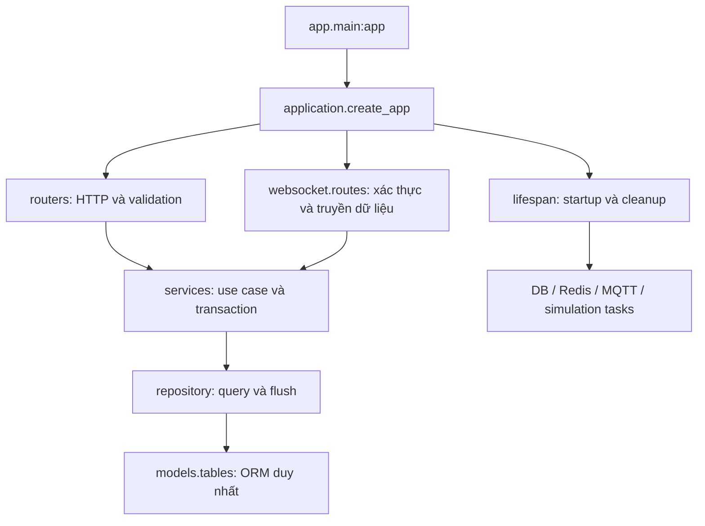

# Refactor và chuẩn hóa backend — 20/10/2026

## Kết quả

Đã rà soát, format Python và tổ chức lại BE trên nhánh `codex/backend-structure-refactor`. Công việc kế thừa workspace đang có các chỉnh sửa Auth/Blockly; các chỉnh sửa đó được giữ nguyên về chức năng. Không chỉnh FE trong đợt refactor này.



## Thay đổi cấu trúc và logic

- `app/main.py` chỉ còn entrypoint; `app/application.py` tạo app, middleware và đăng ký route. Tạo app không mở kết nối mạng.
- `app/lifespan.py` quản lý tài nguyên bằng AsyncExitStack, đóng tài nguyên khi shutdown hoặc startup thất bại giữa chừng; MQTT task có tên và được cancel/await.
- `app/websocket/routes.py` chứa endpoint telemetry và xác thực lại phiên; route `/ws/devices/{device_uid}` và hợp đồng frame giữ nguyên.
- Logging cấu hình lúc startup trong `core/logging.py`, không thay toàn bộ logger lúc import module. Log file nằm trong thư mục logs của backend, độc lập thư mục chạy lệnh.
- `repository/mqtt.py` gom credential/ACL repository, tên MQTTACLRepository phản ánh đúng chức năng. Các module tên cũ vẫn re-export để không phá import cũ.
- Runtime dùng trực tiếp ORM `models.tables`; `models.db_models` vẫn là compatibility shim, không có bộ schema trùng lặp.
- Sinh fragment firmware chuyển khỏi router sang `services/firmware_snippets.py`; repository được dùng lại trong service credential.
- Dọn cache telemetry của thiết bị qua hàm public `clear_device_state`, không truy cập dict private từ DeviceService.
- Hash bcrypt khi tạo/rotate credential chạy trong thread pool để không chặn event loop.
- Redis đóng client khi ping lỗi hoặc bị cancel trong startup; không log URL Redis có thể chứa credential.
- Adapter Mosquitto Docker cũ được đặt trong `integrations/legacy_mosquitto.py`, giữ public compatibility exports. Nó không được dùng trong luồng EMQX/PostgreSQL hiện tại.
- Xóa script test CA thủ công dùng IP/đường CA cũ khỏi thư mục test. Chẩn đoán MQTT dùng `scripts/mqtt_probe.py` và cấu hình env hiện tại.

## Quy chuẩn và lệnh kiểm tra

Thêm `fastapi-backend/pyproject.toml`, pin Ruff trong requirements-dev, chuẩn hóa import/indentation/quote/line wrapping trên Python BE, migration, công cụ compiler và scripts. Không thêm Ruff vào dependency runtime.

```powershell
cd fastapi-backend
python scripts/check_backend.py --postgres
python scripts/check_backend.py --fix
```

`--postgres` bật kiểm thử DB tách biệt, tạo/drop database test riêng. Lệnh check mặc định không thay format; `--fix` mới áp dụng safe fixes và formatter.

Manifest PlatformIO `app/firmware/export_flash_manifest.py` được giữ nguyên byte vì nội dung được hash cùng build profile để kiểm tra image compiler. File vẫn lint với khai báo ngoại lệ cho `env` do SCons cấp. Không thay C++ firmware hay build cache bằng formatter Python.

## Bằng chứng kiểm chứng

| Kiểm tra | Kết quả |
|---|---|
| Baseline trước sửa | 77 tests, OK, 2 skipped, bật PostgreSQL integration |
| Sau refactor | 82 tests, OK, 2 skipped, bật PostgreSQL integration |
| Test mới | Startup lỗi một phần, publisher start lỗi, runtime exception cleanup, Redis lỗi/cancel |
| Ruff lint | PASS |
| Ruff format --check | PASS, 84 files already formatted |
| OpenAPI JSON so với baseline workspace | Giống hệt |
| Danh sách route HTTP/WS | Giống hệt |
| Nội dung build profile _PIO_INI | Giống hệt |
| Byte của manifest compiler | Giống hệt |
| Runtime DB thật | Kết nối thành công, migration hiện hành |
| Runtime MQTT thật | Consumer và publisher kết nối mqtt.p-tech.xyz:8883 thành công |
| GET / và /api/health trong runtime | HTTP 200; mqtt.connected=true, publisher_connected=true |
| Sau shutdown runtime | Không còn asyncio task pending |

Runtime smoke test không publish dữ liệu thiết bị. Redis local đang không có listener tại thời điểm thử; ứng dụng xử lý theo chế độ optional Redis đã có và cleanup bình thường. Chưa build/flash firmware thật trong đợt refactor; compiler được kiểm tra bằng regression tests và đối chiếu fingerprint/profile. Hai test skipped không được coi là đã kiểm chứng.

## Giới hạn ngoài phạm vi đợt này

Đợt refactor không tự bật PostgreSQL Authentication/Authorization trên EMQX server và không thay địa chỉ DB local thành DB truy cập từ server. Việc triển khai server đó vẫn theo `EMQX_POSTGRES_SETUP.md`.

Mô tả cấu trúc và cách chạy chi tiết nằm trong `fastapi-backend/README.md`. Các thay đổi vẫn ở workspace để review; chưa push/merge.
