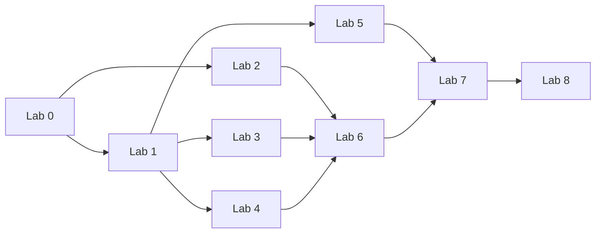

# Kế hoạch phát triển nền tảng học tập CubeSAT

Ngày lập: 22/10/2026. Trạng thái: đề xuất triển khai dựa trên mã nguồn hiện tại; chưa thay đổi chức năng ứng dụng.

## 1. Mục tiêu và phạm vi

Phát triển hệ thống hiện có thành nền tảng quản lý học tập theo lớp: quản trị tài khoản, giảng viên quản lý lớp và sinh viên, học theo lộ trình, mở khóa theo tiến trình, kiểm tra cuối lab và cấu hình nội dung riêng từng lớp.

Các đầu ra bắt buộc:

1. Cấu trúc lại Lab 2–8, thống nhất với nền tảng bài học chung cho Lab 0–8.
2. Phân quyền Admin, giảng viên, tài khoản trải nghiệm và sinh viên theo lớp.
3. Lưu tiến độ từng bài, từng lab, từng lớp; hỗ trợ tiếp tục học.
4. Cấu hình điều kiện mở khóa, ví dụ hoàn thành Lab 0 mở Lab 1 và Lab 2.
5. Bốn loại bài: video, tài liệu, thực hành, lab test; GV có thể cấu hình hoặc tắt.
6. Mỗi lab có ngân hàng 20 câu trắc nghiệm đã duyệt; mỗi lượt thi rút ngẫu nhiên 5 câu.
7. Dashboard Admin và GV; bảng tiến độ, điểm và bài đang chờ chấm.

Phạm vi bản đầu không bao gồm thanh toán, chứng chỉ, thi có giám sát, ứng dụng di động riêng hoặc tự động chấm mọi tình huống phần cứng. Các tính năng này không cần thiết để hoàn thành yêu cầu hiện tại.

## 2. Hiện trạng và phần cần thay đổi

Kết quả kiểm tra mã nguồn ngày 22/10/2026:

| Thành phần | Hiện trạng | Hướng phát triển |
|---|---|---|
| Công nghệ | React/Vite, FastAPI, PostgreSQL, Alembic; đã có compiler, flash, telemetry | Mở rộng ứng dụng hiện tại, chưa cần tách thêm dịch vụ |
| Vai trò | `UserRole` chỉ có `admin`, `user` | Thêm năng lực GV và tư cách thành viên theo lớp |
| Đăng nhập | Có đăng ký/đăng nhập, Google identity, thu hồi token | Tái sử dụng; bổ sung kiểm tra quyền thao tác và phạm vi lớp |
| Giáo trình | Danh mục tĩnh trong `src/data/curriculum.js`, metadata trong `labs.js` | Đưa nội dung, phiên bản và cấu hình lớp vào DB/API |
| Lab 1–8 | 23 video, 18 tài liệu, 32 thực hành, 8 phần tổng hợp | Giữ ID bài thực hành, chuẩn hóa loại bài và thêm lab test |
| Lab 2–8 | 26 bài thực hành | Tổ chức lại theo mục tiêu, đầu ra và tiêu chí chấm |
| Video | URL video Lab 1–8 đang để trống; Lab 0 có URL mẫu | Bổ sung nguồn thật hoặc tắt bài chưa sẵn sàng trước khi xuất bản |
| Tiến độ | `lab_progress` gắn `user_id + lab_id`; Lab 0 cần cờ video/docs, Lab khác chỉ cần compile thành công | Tiến độ mới gắn người học + lớp + phiên bản bài |
| Theo dõi video | `LabLayout` gọi đánh dấu khi mở bài video có URL | Chỉ ghi hoàn thành khi đạt tiêu chí xem, không dựa vào mở trang |
| Quản lý lớp/đề thi | Chưa có model/router tương ứng trong phần mã đã kiểm tra | Xây module lớp học, ngân hàng câu hỏi và lượt thi |
| Bài làm | Có lưu C++/Blockly theo bài trên trình duyệt | Giữ bản nháp; bổ sung nộp bài có phiên bản trên server |

Điểm cần sửa trước khi bật khóa tiến trình: compile thành công chỉ chứng minh mã biên dịch được, chưa chứng minh SV hoàn thành yêu cầu thực hành hoặc cả lab. Hệ thống mới không được kế thừa cách tính này làm tiêu chí mặc định.

## 3. Mô hình vai trò và quyền truy cập

### 3.1. Tách vai trò hệ thống và vai trò trong lớp

- Vai trò hệ thống: `admin`, `teacher`, `user`. Admin cấp/thu hồi quyền GV; đăng ký thông thường luôn tạo `user`.
- Tư cách theo lớp: `teacher` hoặc `student`, kèm trạng thái thành viên. GV chỉ quản lý lớp mình được phân công.
- Tài khoản trải nghiệm là `user` chưa có quyền học trong lớp đang xét, không cần tạo tài khoản mới khi trở thành SV.
- Khi GV thêm một user vào lớp và membership có hiệu lực, user được học các nội dung của lớp theo cấu hình và tiến trình.
- Một tài khoản có thể là SV nhiều lớp, hoặc dạy lớp A và học lớp B. Tiến độ và quyền ở các lớp độc lập.
- Quyền học đầy đủ trong lớp nghĩa là được tiếp cận toàn bộ chương trình được giao; vẫn phải đáp ứng điều kiện mở khóa.

### 3.2. Ma trận quyền

| Thao tác | Admin | GV của lớp | SV đang hoạt động trong lớp | User trải nghiệm |
|---|---|---|---|---|
| Quản lý tài khoản, khóa tài khoản, cấp quyền GV | Có | Không | Không | Không |
| Tạo lớp | Có | Có | Không | Không |
| Thêm/xóa SV, đóng/lưu trữ lớp | Có | Lớp phụ trách | Không | Không |
| Cấu hình nội dung, lộ trình, đề thi | Có | Lớp phụ trách | Không | Không |
| Xem điểm, tiến độ SV | Toàn hệ thống | Lớp phụ trách | Của mình | Tiến độ trải nghiệm của mình |
| Học bài, thực hành, làm test | Chế độ xem thử | Xem thử lớp | Theo quyền và tiến trình | Chỉ nội dung được đánh dấu cho trải nghiệm |
| Xem ngân hàng và đáp án | Có | Ngân hàng có quyền quản lý | Không; chỉ xem phản hồi được công bố | Không |
| Dashboard | Toàn hệ thống | Các lớp phụ trách | Lộ trình cá nhân | Danh mục trải nghiệm |

Mặc định đề xuất cho trải nghiệm: xem giới thiệu Lab 0, một số video/tài liệu và demo trực quan được chọn; không dùng compiler server hoặc lab test tính điểm. Có thể mở riêng bài thực hành mẫu sau khi đặt hạn mức tài nguyên. “TK test” được hiểu là chế độ trải nghiệm của tài khoản cá nhân, không phải tài khoản dùng chung.

### 3.3. Vòng đời lớp và thành viên

- Lớp: `draft → active → archived`; có tên, mã lớp, mô tả, học kỳ và GV phụ trách.
- GV thêm user đã tồn tại bằng email; thao tác thêm lặp lại không tạo membership trùng. Mời người chưa đăng ký bằng email và nhập CSV là phần mở rộng sau bản đầu.
- Xóa SV khỏi lớp: chuyển membership thành `removed`, chặn truy cập lớp và lượt thi tiếp theo; giữ bài nộp/điểm để đối soát.
- Nếu thêm lại cùng SV vào cùng lớp và cùng phiên bản chương trình, mặc định phục hồi tiến độ cũ; reset cần thao tác riêng có ghi lý do.
- Lớp lưu trữ: thành viên còn quyền được xem kết quả, không nộp bài hay bắt đầu lượt thi mới.
- Khóa tài khoản hoặc thu hồi membership phải có hiệu lực tại API, kể cả người dùng còn token hoặc tab đang mở. Bản đầu giữ trạng thái thi nhưng từ chối ghi đáp án/nộp bài sau khi quyền bị thu hồi.
- Quyền học không tự cấp quyền điều khiển thiết bị của người khác. Tiếp tục giữ kiểm tra sở hữu thiết bị hiện có; chia sẻ thiết bị theo nhóm/lớp là hạng mục riêng nếu cần.

## 4. Cấu trúc giáo trình và cấu hình của GV

Mô hình: **Khóa học mẫu → phiên bản giáo trình → Lab → bài học → nội dung và tiêu chí hoàn thành**. Lớp sử dụng một phiên bản đã xuất bản, có cấu hình riêng.

### 4.1. Bốn loại bài học

| Loại | Nội dung GV cấu hình | Hoàn thành mặc định đề xuất |
|---|---|---|
| `video` | URL, tiêu đề, mô tả, thời lượng, ngưỡng xem, bắt buộc/tùy chọn | Xem ít nhất 90% các đoạn thời gian không trùng nhau, có lưu vị trí xem tiếp |
| `document` | Nội dung Markdown/PDF hoặc tài liệu được hỗ trợ, thời lượng dự kiến | SV bấm “Đã đọc”; thao tác mở tài liệu chỉ ghi nhận đã bắt đầu |
| `practice` | Mục tiêu, mã mẫu, board, công cụ, yêu cầu đầu ra, rubric, cách nộp | GV duyệt bài nộp theo rubric; có thể chọn tự động khi bài đã có bộ kiểm tra tin cậy |
| `labtest` | Ngân hàng câu hỏi, thời gian, điểm đạt, số lượt làm, phản hồi | Đạt ngưỡng điểm do GV cấu hình |

Các trường chung: `enabled`, `required`, `order`, `estimated_minutes`, `preview_allowed`, `completion_rule`, trạng thái `draft/published`, phiên bản nội dung.

- Cho phép tắt từng bài hoặc cả loại bài trong một lab, áp dụng riêng từng lớp.
- Bài tắt không xuất hiện trong danh sách phải học, không nằm trong mẫu số tiến độ và không chặn hoàn thành.
- Bài tùy chọn vẫn hiển thị nhưng không chặn mở khóa. Dashboard phân biệt tiến độ bắt buộc và hoạt động bổ sung.
- Bài có nội dung thiếu/URL trống không được xuất bản ở trạng thái bắt buộc. Có thông báo rõ để GV bổ sung hoặc tắt.
- Nếu không còn bài bắt buộc nào trong lab, chặn xuất bản cấu hình đó; GV phải bỏ lab khỏi lộ trình hoặc đặt ít nhất một yêu cầu hoàn thành.
- Tắt cả lab có lab sau phụ thuộc: chặn xuất bản đến khi GV sửa liên kết tiên quyết; không tự coi lab bị tắt là đã đạt.
- Video nhúng cần player hỗ trợ sự kiện xem. Nguồn không đo được tiến độ phải dùng tiêu chí “SV xác nhận đã xem” được GV chọn rõ; không giả lập phần trăm xem. Dữ liệu xem từ trình duyệt là chỉ báo học tập, không phải bằng chứng chống gian lận tuyệt đối.
- Phần `summary` hiện tại chuyển thành bài `document` tổng kết. Mục `components` Lab 0 trở thành bài `practice` khám phá tương tác tùy chọn; không tạo loại bài thứ năm.
- Có chế độ “Xem như sinh viên”, không ghi điểm hay tiến độ thật.

### 4.2. Kế hoạch cấu trúc lại Lab 2–8

Giữ thứ tự học xen kẽ lý thuyết và thực hành theo chủ đề; không gom tất cả video vào một khu riêng làm mất mạch bài học. Lab test nằm cuối lab, sau các yêu cầu học bắt buộc.

| Lab | Nhóm nội dung sau chuẩn hóa | Thực hành hiện có | Minh chứng/đầu ra cần đánh giá |
|---|---|---:|---|
| 2 — Năng lượng EPS | Nguồn và pin → ADC → thư viện pin → tiết kiệm năng lượng | 3 | Đọc điện áp, giải thích kết quả, minh chứng chế độ tiết kiệm năng lượng |
| 3 — Lưu trữ/CDH | MicroSD/SPI → ghi log → quản lý file qua lệnh | 3 | File log đọc được, thao tác ghi/đọc, xử lý lỗi thẻ nhớ |
| 4 — Cảm biến | Môi trường → IMU → GPS → camera → tích hợp cảm biến | 9 | Dữ liệu từng cảm biến và bài tổng hợp; đối chiếu cấu hình phần cứng |
| 5 — Truyền thông | Gửi telemetry → nhận lệnh → liên lạc hai chiều | 5 | Bản tin gửi/nhận, phản hồi lệnh, xử lý tình huống mất kết nối |
| 6 — Cấu trúc và vận hành đa nhiệm | Lắp ráp cơ khí → task/scheduler → khóa tài nguyên → watchdog | 2 | Checklist lắp ráp, lịch chạy task và minh chứng phục hồi khi treo |
| 7 — Tích hợp hệ thống | Multiplexer → chương trình tổng hợp → RTOS | 3 | Kiểm tra tích hợp, giải thích luồng dữ liệu và kết quả nhiệm vụ |
| 8 — Capstone | Yêu cầu nhiệm vụ → thiết kế → triển khai → báo cáo/demo | 1 | Mã nguồn, cấu hình dashboard, dữ liệu demo và báo cáo theo rubric |

Đầu việc nội dung:

1. Chuẩn hóa tên lab, mục tiêu, thời lượng, kiến thức tiên quyết và tiêu chí đạt. Đặc biệt làm rõ Lab 6 gồm cả cơ khí và RTOS; tránh tên lab chỉ mô tả một phần nội dung.
2. Giữ mã của 26 bài thực hành Lab 2–8 để không làm mất liên kết mã mẫu và bản nháp hiện có.
3. Với mỗi bài, bổ sung hướng dẫn, yêu cầu nộp, ví dụ kết quả đúng và lỗi thường gặp.
4. Rà soát phạm vi demo, phần cứng thật và mô phỏng; GV chọn hình thức được chấp nhận trong rubric.
5. Hoàn thiện 20 câu/lab cho Lab 2–8: 140 câu. Để có kiểm tra cuối mọi lab, bổ sung Lab 0–1: tổng 180 câu đã duyệt cho Lab 0–8.
6. Lab 0–1 giữ trọng tâm nội dung hiện có nhưng chuyển sang cùng cấu trúc bốn loại bài và tiến độ mới.

## 5. Tiến trình học và mở khóa

### 5.1. Trạng thái và cách tính

Phân biệt quyền truy cập (`locked/available`) với trạng thái học (`not_started/in_progress/pending_review/completed`). Lab test có thêm `failed/passed` ở kết quả lượt thi.

```text
Tiến độ lab = số bài bắt buộc đang bật đã hoàn thành
              / tổng số bài bắt buộc đang bật × 100%

Lab hoàn thành = mọi bài bắt buộc đang bật đã hoàn thành,
                bao gồm lab test nếu lab test được đặt bắt buộc.

Tiến độ khóa học = số lab bắt buộc đã hoàn thành
                  / tổng số lab bắt buộc trong lộ trình × 100%.
```

Tiến độ phần trăm chỉ để trình bày; quyền mở khóa dựa trên trạng thái hoàn thành do backend tính. Không dùng giá trị làm tròn 100% làm điều kiện nghiệp vụ. Bài nộp chờ GV duyệt chưa được tính hoàn thành.

Lưu vị trí học cuối và nút “Tiếp tục học”; nếu bài cuối đã hoàn thành thì gợi ý bài tiếp theo đủ điều kiện. Khi bài khóa, hiển thị rõ điều kiện còn thiếu.

### 5.2. Lộ trình mẫu đề xuất



Nhiều mũi tên đi vào một lab nghĩa là phải hoàn thành tất cả các lab tiên quyết. Lộ trình này là đề xuất cho CubeSAT, không phải quy tắc được sao chép từ Coursera.

Lab 2 được mở cùng Lab 1 sau Lab 0 như yêu cầu. Riêng các bài lập trình trong Lab 2 có thể yêu cầu hoàn thành bài nhập môn IDE/nạp code của Lab 1; GV có thể bỏ điều kiện này với lớp đã có kiến thức nền.

GV chọn mẫu tuần tự hoặc mẫu phân nhánh và chỉnh tiên quyết. Backend kiểm tra không có chu trình, không có phụ thuộc vào bài/lab đã tắt hoặc ngoài phiên bản lớp. Bản đầu hỗ trợ điều kiện AND; biểu thức điều kiện phức tạp để giai đoạn sau.

Cho phép GV miễn một yêu cầu hoặc mở khóa riêng cho SV có lý do và nhật ký. Miễn yêu cầu được ghi là `waived`, không giả thành một điểm thi; được tính thỏa điều kiện học theo chính sách lớp.

### 5.3. Thay đổi cấu hình khi lớp đang học

- Cấu hình nháp không ảnh hưởng SV; xuất bản tạo phiên bản mới và hiển thị trước số SV bị tác động.
- Lớp đang hoạt động tiếp tục dùng phiên bản đã gán. Bản đầu cho phép cập nhật nội dung không đổi tiêu chí; đổi số bài bắt buộc, tiên quyết hoặc ngưỡng đạt cần tạo phiên bản chương trình mới.
- Chuyển lớp đang học sang phiên bản mới là thao tác quản trị riêng, có bảng ánh xạ và báo cáo tác động. Không tự động reset kết quả hoặc khóa lại bài đã đạt.
- Lượt thi đang làm giữ nguyên bộ câu hỏi, ngưỡng đạt và giới hạn thời gian tại lúc bắt đầu.

## 6. Lab test và sinh ngân hàng câu hỏi

### 6.1. Sinh câu hỏi và duyệt nội dung

1. GV chọn lab và phiên bản tài liệu làm nguồn.
2. Chức năng sinh câu hỏi tạo bản nháp: câu hỏi, bốn lựa chọn, một đáp án đúng, giải thích, mục tiêu kiến thức, độ khó và tham chiếu phần nguồn.
3. Kiểm tra định dạng, lựa chọn trùng, đáp án thiếu và câu hỏi gần trùng; GV sửa/duyệt chất lượng chuyên môn.
4. Xuất bản ngân hàng gồm 20 câu hợp lệ, đủ bao phủ mục tiêu lab. Có thể lưu thêm câu nháp nhưng mỗi phiên bản ngân hàng dùng thi ban đầu gồm đúng 20 câu.
5. Chỉ các câu đã duyệt mới được dùng. Không sinh câu hỏi mới trực tiếp trong lúc SV làm bài.

Nếu dùng mô hình AI, cấu hình nhà cung cấp và khóa ở server, giới hạn nguồn gửi là tài liệu lab đã chọn, không gửi dữ liệu cá nhân/điểm của lớp. Có trạng thái job, retry, hạn mức chi phí và lịch sử người duyệt. Nhập thủ công hoặc import JSON/CSV vẫn dùng được nếu dịch vụ sinh câu hỏi chưa sẵn sàng.

### 6.2. Tạo đề và chấm bài

- Server lấy ngẫu nhiên 5 câu khác nhau từ ngân hàng 20 câu; xáo thứ tự câu và lựa chọn, giữ ID lựa chọn ổn định.
- Mỗi lượt thi lưu snapshot phiên bản câu hỏi, thứ tự và đáp án đúng phía server. Refresh/reconnect trả lại cùng đề, không rút lại.
- Đáp án đúng và lời giải không nằm trong bundle frontend hoặc response lúc đang làm bài.
- Server kiểm tra membership, quyền mở khóa, số lượt còn lại và thời gian trước khi tạo/nộp lượt thi.
- Chấm trên server: mỗi câu 1 điểm. Mặc định đề xuất đạt 4/5 (80%), thời gian 10 phút, tối đa 3 lượt; GV cấu hình các giá trị này.
- Giữ 5 câu/đề và ngân hàng 20 câu theo yêu cầu bản đầu. Nếu mở cấu hình số câu về sau, phải kiểm tra số lượng hợp lệ và ngưỡng đạt tương ứng.
- Lưu đáp án tạm để tiếp tục khi mất mạng. Đồng hồ dựa vào thời gian server; hết giờ chấm theo đáp án đã lưu. Giới hạn một lượt đang hoạt động cho mỗi SV và bài test.
- Nộp lặp lại trả cùng kết quả; thao tác đồng thời không tạo thêm lượt, không vượt giới hạn và không cộng tiến độ hai lần.
- Không yêu cầu hai SV luôn nhận hai đề khác nhau: random có thể trùng hợp lệ. Không lặp câu trong cùng một đề.
- Mặc định hiển thị điểm/đạt ngay; chỉ công bố đáp án và giải thích sau khi hết lượt hoặc kết thúc đợt kiểm tra. GV có thể đổi thời điểm công bố.
- Lưu mọi lần làm; dùng điểm cao nhất để xét đạt. GV có thể cấp thêm lượt có lý do.
- Không cho xuất bản lab test khi chưa đủ 20 câu đã duyệt. Thu hồi câu sai sau xuất bản cần tạo phiên bản và có quy trình xử lý điểm ảnh hưởng, không âm thầm sửa lịch sử thi.

## 7. Kiến trúc dữ liệu và API dự kiến

### 7.1. Các nhóm bảng

| Nhóm | Bảng/thực thể đề xuất | Ràng buộc chính |
|---|---|---|
| Tài khoản | Mở rộng `users`, trạng thái tài khoản | Không nhận role nâng quyền từ đăng ký công khai |
| Lớp học | `classes`, `class_memberships` | Unique lớp + user; role, trạng thái, ngày thêm/xóa |
| Giáo trình | `courses`, `course_versions`, `labs`, `lessons` | ID ổn định, phiên bản bất biến sau xuất bản |
| Cấu hình lớp | `class_course_versions`, `class_lesson_settings`, `prerequisites` | Bài thuộc đúng phiên bản lớp; đồ thị không chu trình |
| Tiến độ | `lesson_progress`, `progress_events`, `completion_overrides` | Unique membership + lesson version; sự kiện có khóa chống lặp |
| Bài thực hành | `practice_submissions`, `practice_reviews` | Gắn SV/lớp/bài, bản mã nộp, rubric và người chấm |
| Kiểm tra | `question_banks`, `question_versions`, `quiz_policies` | Ngân hàng theo lab/version; đáp án chỉ ở server |
| Lượt thi | `quiz_attempts`, `quiz_attempt_items`, `quiz_answers` | Snapshot, hạn nộp, số lượt, điểm và trạng thái |
| Vận hành | `audit_logs`, `question_generation_jobs` | Lưu đổi quyền, cấu hình, điểm, miễn trừ và kết quả sinh câu |

Tiến độ lab/khóa học được tính từ tiến độ bài và cấu hình đã xuất bản; chỉ thêm bảng tổng hợp/cache khi cần hiệu năng. `quiz_attempts` và bài nộp đều phải gắn membership để tránh dùng kết quả lớp A mở khóa lớp B.

### 7.2. Nhóm API

| API dự kiến | Trách nhiệm |
|---|---|
| `/api/admin/users`, `/api/admin/dashboard` | Quản lý tài khoản, vai trò, tổng quan hệ thống |
| `/api/classes`, `/api/classes/{id}/members` | Tạo/sửa/lưu trữ lớp, thêm/xóa SV |
| `/api/classes/{id}/curriculum`, `/settings`, `/publish` | Đọc cấu hình hiệu lực, sửa nháp, kiểm tra và xuất bản |
| `/api/classes/{id}/learning-path`, `/progress` | Lộ trình, trạng thái khóa và tiến độ trong lớp |
| `/api/classes/{id}/lessons/{lessonId}/events` | Ghi sự kiện xem/đọc theo policy, không nhận điểm hay quyền mở khóa từ client |
| `/api/classes/{id}/lessons/{lessonId}/submissions` | Nộp thực hành, xem nhận xét; API chấm riêng cho GV |
| `/api/classes/{id}/labs/{labId}/question-bank` | Soạn, sinh, duyệt, xuất bản ngân hàng |
| `/api/classes/{id}/labs/{labId}/attempts` | Bắt đầu lượt thi hoặc trả lượt đang làm |
| `/api/attempts/{id}/answers`, `/submit`, `/result` | Lưu đáp án, chấm, phản hồi theo quyền người sở hữu |
| `/api/classes/{id}/reports` | Báo cáo lớp và xuất CSV |

Đây là phạm vi hợp đồng dự kiến; chốt schema request/response trong Sprint 1. API nên trả mã lý do có cấu trúc như `PREREQUISITE_NOT_MET`, `MEMBERSHIP_REQUIRED`, `ATTEMPT_LIMIT_REACHED` để giao diện giải thích rõ.

### 7.3. Vị trí tích hợp với mã hiện tại

- `fastapi-backend/app/models/tables.py` và Alembic: thêm mô hình lớp, nội dung, tiến độ, đề thi.
- `services/auth.py`: bổ sung dependency kiểm tra vai trò và membership hiện hành; không chỉ tin role trong JWT.
- `services/progress.py`, `routers/progress.py`: thay logic hoàn thành lab bằng tiến độ bài theo lớp; đường API cũ không được trở thành lối vượt khóa.
- `routers/compiler.py`: thêm ngữ cảnh lớp/bài thực hành, xác minh trước compile và trước ghi kết quả; bỏ việc compile bất kỳ mã nào là hoàn thành lab.
- `routers/curriculum.py`: bảo vệ nội dung và mã mẫu theo lớp/bài; nguồn công khai ngoài hệ thống vẫn là tài nguyên công khai, không cam kết thu hồi bản đã tải.
- `src/data/curriculum.js`, `labs.js`, `lesson-reading.js`: dùng làm dữ liệu seed, chuyển nội dung hạn chế sang API; tránh đóng gói toàn bộ tài liệu riêng trong JavaScript public.
- `App.jsx`, `AuthContext`, `LabLayout`, `CourseSidebar`: bổ sung ngữ cảnh lớp, điều hướng theo quyền, tiến độ và nguyên nhân khóa; cập nhật cả nhận diện route trong layout.
- `VideoPlayer`: bổ sung lưu vị trí và sự kiện xem thực thay cho đánh dấu lúc mở.
- `LabWorkspace`, editor, compiler/flash/telemetry: tái sử dụng; truyền lesson/class context và tách kết quả compile khỏi kết quả đánh giá.
- Bản nháp trình duyệt mới có namespace user/lớp/bài; bản nháp legacy không rõ chủ sở hữu chỉ phục hồi qua thao tác chủ động, không tự gán cho người đăng nhập khác.

Kiểm tra quyền tại mọi API nội dung, mã mẫu, nộp bài, đề thi, kết quả và báo cáo; không dựa vào việc ẩn nút phía frontend. Flash USB chạy trên máy người dùng không thể thu hồi firmware đã tải; hệ thống chỉ kiểm soát dịch vụ và tài nguyên do mình cung cấp.

## 8. Các màn hình cần xây dựng

- **Admin:** dashboard số tài khoản/lớp đang hoạt động; tìm kiếm tài khoản, trạng thái, cấp quyền GV, nhật ký thao tác và quản lý giáo trình mẫu.
- **GV:** danh sách lớp → chi tiết lớp với danh sách SV, chương trình, cấu hình bài, điều kiện mở khóa, ngân hàng câu hỏi, bài chờ chấm, báo cáo.
- **SV:** lớp của tôi → lộ trình → tiếp tục học; trạng thái từng bài, bài nộp/nhận xét, lượt thi còn lại và kết quả.
- **User trải nghiệm:** nội dung được xem thử và chỉ dẫn tham gia lớp; các mục bị giới hạn giải thích điều kiện truy cập.

Dashboard lớp gồm tiến độ từng SV, số lab đã đạt, điểm test cao nhất, số lượt làm, bài chờ duyệt và lần hoạt động gần nhất. Admin xem tổng hợp toàn hệ thống; định nghĩa rõ bộ lọc thời gian để tránh hiểu “đã đăng nhập” là “đang học”.

## 9. Kế hoạch triển khai theo sprint

Ước lượng sơ bộ: **10 tuần, 5 sprint × 2 tuần**, với giả định 1 lập trình viên backend, 1 frontend làm toàn thời gian, QA hỗ trợ và 1 GV phụ trách nội dung tham gia xuyên suốt. Cần hiệu chỉnh sau Sprint 1; thời gian cung cấp video/tài liệu và duyệt 180 câu là phụ thuộc riêng, có thể kéo dài lịch. Không coi đây là cam kết ngày phát hành khi chưa xác nhận nhân lực.

| Sprint | Trọng tâm và đầu việc | Đầu ra nghiệm thu | Phụ thuộc |
|---|---|---|---|
| 1 — Tuần 1–2 | Chốt nghiệp vụ, role/membership, schema/migration; quản lý user và lớp cơ bản; hợp đồng API; kiểm kê nội dung | Admin cấp GV; GV tạo lớp và thêm/xóa user; API từ chối quyền sai lớp | Nghiệp vụ và dữ liệu hiện tại |
| 2 — Tuần 3–4 | Seed giáo trình, cấu trúc Lab 2–8, bốn loại bài, cấu hình bật/tắt/bắt buộc, phiên bản và xuất bản | GV cấu hình lớp thử; SV chỉ thấy nội dung hiệu lực; giữ ID bài/mã mẫu | Sprint 1 |
| 3 — Tuần 5–6 | Tiến độ bài, lưu vị trí, điều kiện tiên quyết, nộp/chấm thực hành, miễn trừ; bỏ hoàn thành theo compile | Luồng Lab 0 → Lab 1/Lab 2 chạy đúng; lớp A/B độc lập; tắt bài không chặn tiến độ | Sprint 2; rubric mẫu đã duyệt |
| 4 — Tuần 7–8 | Ngân hàng, sinh câu nháp, duyệt; random 5/20, lưu lượt, chấm, retry, phản hồi | Hoàn thành luồng cuối lab → test → đạt → mở lab kế tiếp | Sprint 3; ngân hàng mẫu được duyệt |
| 5 — Tuần 9–10 | Dashboard, CSV, hoàn thiện nội dung, migration rehearsal, kiểm thử toàn luồng, pilot và sửa lỗi | Nghiệm thu một lớp thật; không hồi quy compiler/flash/telemetry; đủ nội dung phát hành | Sprint 1–4; QA, GV và thiết bị |

Công việc nội dung chạy song song: Sprint 1 thống nhất mục tiêu/rubric; Sprint 2–3 hoàn thiện tài liệu/video và soạn câu; Sprint 4 duyệt toàn bộ ngân hàng; Sprint 5 chạy thử giảng dạy. Đây là phân công công việc dự kiến cho nhóm triển khai, không phải các công việc đã được thực hiện.

Mốc demo: cuối Sprint 1 quản lý lớp; cuối Sprint 2 cấu hình chương trình; cuối Sprint 3 học theo tiến trình; cuối Sprint 4 học và thi đầy đủ; cuối Sprint 5 bản pilot được nghiệm thu.

### Backlog ưu tiên

| Mã | Mức | Công việc | Chủ trì |
|---|---|---|---|
| AUTH-01 | P0 | Role hệ thống, membership, chặn truy cập chéo lớp, khóa tài khoản | Backend |
| CLASS-01 | P0 | CRUD lớp, thêm/xóa SV, lưu trữ lớp | Backend + Frontend |
| CONTENT-01 | P0 | Schema, seed ID ổn định, bốn loại bài, chuyển Lab 2–8 | Backend + GV |
| CONFIG-01 | P0 | Bật/tắt, bắt buộc, draft/publish, phiên bản | Frontend + Backend |
| PROGRESS-01 | P0 | Tiến độ từng bài, tiếp tục học, sự kiện chống lặp | Backend + Frontend |
| PATH-01 | P0 | Điều kiện mở khóa, kiểm tra chu trình, miễn trừ | Backend |
| PRACTICE-01 | P0 | Nộp bài, rubric, GV duyệt; tách compile khỏi hoàn thành | Backend + Frontend + GV |
| QUIZ-01 | P0 | Ngân hàng 20 câu/lab, phiên bản và duyệt | Backend + Frontend + GV |
| QUIZ-02 | P0 | Lượt thi 5 câu, chấm server, giới hạn lượt/thời gian | Backend + Frontend |
| GEN-01 | P0 | Sinh câu nháp từ tài liệu, kiểm tra chất lượng, nhập dự phòng | Backend + GV |
| REPORT-01 | P0 | Dashboard Admin/GV và báo cáo lớp cơ bản | Frontend + Backend |
| RELEASE-01 | P0 | Migration, kiểm thử quyền, pilot và rollback | Backend + QA |
| CLASS-02 | P1 | Mời qua email, nhập SV hàng loạt, nhiều GV đồng quản trị | Backend + Frontend |
| LEARN-02 | P1 | Nhắc học, lịch học cá nhân, phân tích câu khó | Frontend + Backend |
| PRACTICE-02 | P1 | Mở rộng chấm tự động với thiết bị/mô phỏng, bài nhóm | Backend + GV |

## 10. Di chuyển dữ liệu và phát hành

1. Backup DB, kiểm kê người dùng và tiến độ legacy; chạy migration thử trên bản sao dữ liệu.
2. Thêm bảng mới trước, seed giáo trình bằng ID hiện tại; không xóa `lab_progress` hoặc bản nháp trình duyệt trong đợt đầu.
3. Không tự coi `compiled_at` là đã hoàn thành mọi thực hành/test mới. Lưu thành lịch sử legacy; GV có thể công nhận tương đương bằng miễn trừ có lý do.
4. Dữ liệu cũ không có class ID: không tự gán toàn bộ user vào một lớp. Tạo lớp pilot và danh sách thành viên cụ thể; báo cáo ánh xạ dữ liệu để kiểm tra trước khi import.
5. Bật hệ thống mới cho lớp pilot qua feature flag. Ngoài pilot giữ chính sách cũ được ghi rõ; khi mở rộng, loại bỏ đường API cũ có thể vượt quy tắc mới.
6. Với URL `/labN?lesson=...` cũ: một lớp hợp lệ thì chuyển đến đúng lớp; nhiều lớp thì cho chọn; không có lớp thì đưa về trải nghiệm phù hợp.
7. Kiểm tra số lượng bài, mapping ID, membership, điểm và tiến độ sau chuyển đổi. GV nghiệm thu học liệu và rubric trước khi mở lớp thật.
8. Nếu có lỗi nghiêm trọng, tắt quyền ghi của lớp pilot và quay về luồng ổn định; giữ nguyên dữ liệu mới để khôi phục. Không downgrade DB phá dữ liệu hoặc đưa lớp bị khóa vào đường truy cập legacy rộng quyền hơn.

## 11. Tiêu chí nghiệm thu và kiểm thử

| Nhóm | Tình huống phải đạt |
|---|---|
| Phân quyền | User không tự nâng role; GV lớp A không xem/sửa lớp B; SV không lấy bài/điểm người khác; gọi API trực tiếp vẫn bị chặn |
| Thu hồi | Xóa SV/khóa tài khoản chặn truy cập với token và tab cũ; lưu bài đang thi tuân thủ chính sách thu hồi |
| Cấu hình | Tắt video/docs/practice/test không gây deadlock; cấu hình không còn yêu cầu, phụ thuộc bị tắt hoặc có chu trình bị từ chối |
| Tiến độ | Mở trang không hoàn thành video; compile đơn thuần không hoàn thành lab; sự kiện lặp không tăng tiến độ; tải lại vẫn đúng |
| Nhiều lớp | Cùng SV học hai lớp có cấu hình khác nhau, không dùng tiến độ/điểm lớp này mở khóa lớp kia |
| Thực hành | Nộp đúng ngữ cảnh lớp/bài, GV chấm theo rubric, SV xem nhận xét; bài chờ chấm chưa mở khóa |
| Đề thi | 20 câu đã duyệt; 5 câu không trùng/đề; không lộ đáp án; refresh giữ đề; ngân hàng thay đổi không sửa lượt cũ |
| Đồng thời | Double-click bắt đầu/nộp, hai tab, hết giờ, mất mạng, nộp muộn và hết lượt đều nhất quán |
| Phiên bản | Sửa nháp không đổi lớp đang học; chuyển phiên bản không tự xóa kết quả; ngưỡng đạt cũ được lưu với lượt thi |
| Hồi quy | Đăng nhập, C++/Blockly, compiler, tải artifact, flash và telemetry vẫn hoạt động với người dùng có quyền |
| Di chuyển | Mapping ID đúng, dữ liệu legacy giữ nguyên, phục hồi được sau rollback và kiểm chứng backup |

Sử dụng bộ kiểm tra hiện có (`npm run check`, `npm run build`) khi triển khai code, bổ sung unit/integration cho quyền, tiến độ và lượt thi; E2E cho các luồng liên vai trò. Kiểm thử flash/telemetry trên thiết bị thật ở pilot. Chốt tải đồng thời theo quy mô lớp trong Sprint 1 và đo API tiến độ, đề thi, dashboard ở mức tải đó.

Definition of Done: code và migration được review; kiểm thử nghiệp vụ đạt; học liệu/ngân hàng được GV duyệt; không còn lỗi chặn truy cập/học/thi; pilot được nghiệm thu; có hướng dẫn Admin/GV/SV và phương án phục hồi đã thử.

## 12. Các giả định cần chốt trong Sprint 1

Các mục sau đang có mặc định đề xuất để đủ cơ sở ước lượng, không phải quyết định sản phẩm đã được xác nhận:

| Chủ đề | Mặc định đề xuất | Người chốt |
|---|---|---|
| Phạm vi lab test | Lab 0–8, tổng 180 câu; ưu tiên cấu trúc nội dung Lab 2–8 | Chủ sản phẩm + GV |
| Điểm và lượt thi | Đạt 4/5, 10 phút, 3 lượt, lấy điểm cao nhất | GV |
| Video | Ngưỡng 90% nếu player đo được; nguồn không đo được có chế độ xác nhận rõ ràng | GV + nhóm kỹ thuật |
| Chấm thực hành | GV duyệt theo rubric, tự động ở bài có kiểm tra tin cậy | GV |
| Trải nghiệm | Lab 0 và nội dung chọn lọc, chưa dùng compiler server/thi tính điểm | Chủ sản phẩm |
| Lộ trình | Lab 0 mở Lab 1 và Lab 2; phần sau dùng sơ đồ mục 5 | GV |
| AI sinh câu hỏi | Chọn nhà cung cấp, ngân sách và nguồn học liệu; có nhập thủ công dự phòng | Chủ sản phẩm + kỹ thuật |
| Nhân lực/tải | Hai dev, QA hỗ trợ, GV nội dung; xác định số lớp và SV đồng thời | Quản lý dự án |

Ưu tiên bắt đầu bằng role/membership và schema nội dung theo lớp. Đây là nền tảng để tiến độ, khóa bài, đề thi và dashboard sử dụng cùng một mô hình quyền và dữ liệu.

## 13. Tham khảo

- [Coursera — Foundations of Teaching for Learning: Planning for Teaching and Learning](https://www.coursera.org/learn/teaching-plan): ví dụ tổ chức khóa học theo module, mỗi module kết hợp video, bài đọc và bài đánh giá. Dùng làm tham khảo cấu trúc học tập; không suy diễn rằng Coursera áp dụng đúng quy tắc mở khóa, 90% video hay đề 5/20 của kế hoạch này.
- `Docs/CURRICULUM.md`, `src/data/curriculum.js`: giáo trình hiện có và ID các bài.
- `src/components/layout/LabLayout.jsx`, `src/components/common/VideoPlayer.jsx`: cách hiển thị bài và ghi nhận video/docs hiện tại.
- `fastapi-backend/app/models/tables.py`, `services/progress.py`, `routers/compiler.py`: vai trò, dữ liệu tiến độ và cách ghi nhận compile hiện tại.

Nguồn web được tham khảo ngày 22/10/2026. Các chính sách chi tiết trong kế hoạch là đề xuất dành riêng cho CubeSAT.
