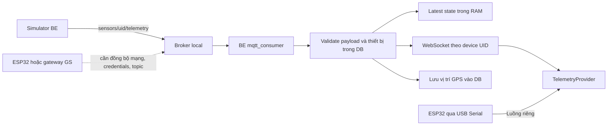

# Kiểm tra MQTT hiện trạng — 16/10/2026

Phạm vi: đọc mã nguồn, cấu hình thực tế và kiểm tra kết nối broker local. Không sửa runtime, không phát telemetry, không nạp firmware. Mốc mã nguồn: main `2595a04`.

## Kết luận

Broker local hoạt động và tài khoản BE đăng nhập/subscribe được. Tuy nhiên, luồng thiết bị thật → MQTT → BE → FE chưa đồng bộ: broker chỉ nghe qua loopback của máy host, đăng ký thiết bị chưa provision vào broker, firmware Lab7 dùng topic khác hợp đồng BE. Việc Serial hiển thị đúng không chứng minh MQTT đã hoạt động xuyên suốt.

## Cài đặt và cấu hình

| Thành phần | Hiện trạng |
|---|---|
| Khởi động dev | `npm run dev` có predev gọi `dev:services`, chạy `fastapi-backend/local_services.py` |
| Broker đang chạy | Container `pscubesat-dev-mqtt-1`, image `eclipse-mosquitto:2`, Up khoảng 21 giờ tại thời điểm kiểm tra |
| Cổng host | `127.0.0.1:1883`; ESP32 ở máy khác trong LAN không truy cập trực tiếp được |
| Cấu hình BE thực tế | localhost:1883, username backend-service, password có cấu hình, subscribe sensors/# |
| File broker thực sự dùng | `fastapi-backend/data/local-services/config/`, mount read-only trong container |
| Xác thực dev | Không anonymous; password file và ACL; không TLS; persistence false |
| ACL dev | Chỉ backend-service, readwrite sensors/# và cmd/# |
| Cấu hình cũ | `mosquitto/config/mosquitto.conf` có 1883, WebSocket 9001, TLS 8883 đang comment; không phải config dev đang chạy |
| Compose chính | `docker-compose.yml` hiện không khai báo broker; BE cũng không mount /mosquitto/config |

`local_services.py` tạo mật khẩu nếu chưa có, lưu vào .env, dùng mosquitto_passwd để hash, sau đó up container và HUP reload. Mỗi lần chạy lại script sẽ ghi lại passwd/ACL chỉ gồm service account: không phù hợp để giữ tài khoản thiết bị được thêm thủ công. Không chạy lại script này trong đợt kiểm tra.

Script cũ `scripts/init_mosquitto.sh` dùng mật khẩu mẫu cố định và tùy chọn `-c` tạo lại password file; hướng dẫn compose mosquitto trong script không còn khớp compose chính. Nên hợp nhất cơ chế bootstrap trước khi triển khai lại.

## Luồng dữ liệu

- Simulator publish QoS 1 tới `sensors/{device_uid}/telemetry` bằng tài khoản service. Consumer subscribe mặc định QoS 0: chưa có cam kết QoS 1 xuyên suốt tới BE.
- Consumer chỉ chấp nhận topic đúng mẫu trên, payload bytes tối đa 65.536 byte, JSON hợp lệ và device_id trùng UID trong topic. Thiết bị phải tồn tại, enabled và có chủ sở hữu.
- `app/models/telemetry.py` chuyển payload flat/nested thành TelemetryFrame chuẩn. Số không hữu hạn bị chặn; giá trị thiếu giữ null.
- BE lưu frame mới nhất trong RAM, gửi WebSocket theo thiết bị; GPS ghi DB tối đa một lần/3 giây/thiết bị. Đây chưa phải kho lịch sử telemetry đầy đủ.
- FE hardware/simulator dùng `/ws/devices/{uid}` và `/api/telemetry/latest/{uid}`; không kết nối broker trực tiếp. Chế độ Serial và demo có nguồn dữ liệu riêng.
- Có ACL/topic `cmd/{uid}`, nhưng chưa thấy luồng API command → MQTT publish → device ACK hoàn chỉnh trong mã BE hiện tại.

## Các điểm cần sửa trước

### 1. Provision và thu hồi tài khoản thiết bị chưa nối với broker

`app/services/device.py` tạo Device, MQTTCredential và MQTTACL trong DB, trả secret một lần. Không gọi `mosquitto_mgr.add_device`. Mosquitto dev đọc password/ACL file, không đọc những bảng DB này; tài khoản vừa đăng ký chưa thể dùng để login broker hiện tại.

Xóa thiết bị đã thu hồi quyền tại DB, dừng simulation, xóa cache và đóng WebSocket; consumer cũng bỏ dữ liệu thiết bị vô hiệu. Tuy nhiên chưa gọi thu hồi tài khoản broker. Nếu tài khoản từng được provision ngoài luồng, quyền broker cần được thu hồi riêng.

`mosquitto_mgr.py` hiện là module chưa được nối vào service: hardcode container `mosquitto`, đường dẫn /mosquitto/config, khác deployment dev; mount config dev read-only cũng không cho exec sửa file. Có thêm các vấn đề cần xử lý khi tái sử dụng: ghi ACL không atomic/không khóa; kiểm tra user bằng substring; remove bỏ qua kết quả xóa password; reload lỗi chỉ warning nhưng hàm ngoài vẫn có thể báo thành công.

### 2. Firmware và BE khác hợp đồng

`compiler/overrides/CDH/CDH.cpp` chỉ cấu hình MQTT nếu macro MQTT_HOST được định nghĩa; build profile hiện không cấp các macro MQTT_HOST/PORT/USER/PASS. Định nghĩa biến hoặc macro chỉ trong sketch không tự cấu hình translation unit CDH.cpp của thư viện.

CDH dùng WiFiClientSecure, `setInsecure()` và client ID cố định `CubeSat_Client`; cần TLS đúng CA, ID riêng từng thiết bị và reconnect có backoff. Hàm publish bỏ qua kết quả trả về, nên chưa phản ánh lỗi gửi cho lớp gọi.

`app/firmware/curriculum/Lab7-03_RTOS_Satellite_System.cpp` publish `cubesat/telemetry/...`, không khớp `sensors/{uid}/telemetry`. Cần đồng bộ cả topic, UID và payload, không chỉ đổi địa chỉ broker.

Firmware snippet ở `app/routers/devices.py` lại dùng hostname mẫu, port 8883 nhưng WiFiClient thường; không phù hợp TLS broker. Secret trong snippet GET là placeholder do chỉ trả secret thật lúc đăng ký.

### 3. Mạng và TLS cần thống nhất

Chọn broker local LAN hay broker Internet trước. Hiện port chỉ bind loopback, không có TLS listener dev. BE bật TLS dựa duy nhất vào port == 8883, luôn truyền is_ip_address=True làm tắt hostname verification, kể cả khi dùng domain. Nên cấu hình TLS/CA rõ ràng và xác minh tên/IP bằng chứng chỉ phù hợp.

### 4. Độ bền và khả năng quan sát

- Simulator connection loop chỉ chờ sự kiện stop sau khi kết nối; không trực tiếp theo dõi mất kết nối, lỗi publish xảy ra ở task gọi ngoài vòng reconnect. Cần kiểm thử broker restart và sửa cơ chế reconnect này; chưa thực hiện fault injection trong đợt audit.
- Consumer xử lý tuần tự; mỗi frame vẫn query DB, sau đó chờ gửi WebSocket. Gửi các socket đồng thời nhưng chưa có timeout từng socket, nên client chậm có thể giữ lượt xử lý.
- Latest state và các room WebSocket nằm trong RAM từng process; cần thiết kế lại nếu chạy nhiều worker, cùng chính sách TTL/offline và lưu trữ.
- `/api/health` hiện không báo trạng thái MQTT. Container MQTT cũng chưa có healthcheck kiểm chứng xác thực/subscription.
- Broker log cảnh báo owner/permissions ACL trên bind mount Windows; cần chuẩn hóa khi đóng gói Linux, không chỉ bỏ qua cảnh báo.
- Giới hạn payload tổng 64 KiB và image_data 60.000 ký tự cần được tính riêng nếu định truyền ảnh camera; không mặc định mọi ảnh JPEG sẽ vừa.

## Kiểm chứng thực tế

- Docker compose ps: MQTT đang chạy, bind đúng 127.0.0.1:1883.
- Đọc config/ACL được mount: khớp bootstrap dev và service account.
- Đăng nhập bằng settings BE và subscribe sensors/#: **PASS**, không publish thử.
- Probe Python đầu tiên dùng loop mặc định Windows bị NotImplementedError ở add_reader/add_writer. Chạy lại với WindowsSelectorEventLoopPolicy: PASS. Đây là yêu cầu tương thích của probe aiomqtt, không phải bằng chứng broker hỏng; dev Uvicorn reload hiện dùng Selector (compiler có bridge Proactor riêng). Cần kiểm tra lại khi đổi cách khởi động BE trên Windows.
- Chưa kiểm thử end-to-end thiết bị thật/GS → broker → UI, thu hồi tài khoản, restart broker, tải đồng thời hay TLS. Không kết luận các luồng này đã đạt chỉ từ việc connect/subscribe thành công.

## Thứ tự triển khai đề xuất

1. Chốt topology: ESP32 nối MQTT trực tiếp qua Wi-Fi hay OBC → LoRa → GS → MQTT; broker ở LAN hay server. Quy định identity riêng cho gateway và vệ tinh nếu đi qua GS.
2. Chốt contract versioned: telemetry, status/LWT, command, ACK; đơn vị đo, timestamp, seq, QoS, retained và timeout.
3. Hợp nhất cấu hình broker, TLS và cơ chế provision/revoke; bỏ cấu hình mẫu lệch thực tế. Giữ tài khoản thiết bị qua lần khởi động lại.
4. Sửa firmware/gateway theo contract, client ID riêng, reconnect, kiểm tra kết quả publish; sinh snippet theo cấu hình thật.
5. Bổ sung health MQTT, timeout/queue xử lý, trạng thái stale/offline, chiến lược lưu dữ liệu và hỗ trợ nhiều worker nếu cần.
6. Test hai thiết bị đồng thời; topic/UID sai; credential sai; xóa thiết bị; mất Wi-Fi; restart broker; nhận telemetry và command ACK trên UI. GPS/LoRa ngoài phạm vi kiểm thử phần cứng đã thống nhất trước đó.

Các file trọng tâm: `fastapi-backend/local_services.py`, `docker-compose.dev.yml`, `app/core/config.py`, `app/services/device.py`, `app/services/mosquitto_mgr.py`, `app/services/mqtt_consumer.py`, `app/services/simulation/mqtt_publisher.py`, `app/models/telemetry.py`, `app/routers/devices.py`, `compiler/overrides/CDH/CDH.cpp` (các đường app/compiler tính từ fastapi-backend), và `src/contexts/TelemetryContext.jsx`.
