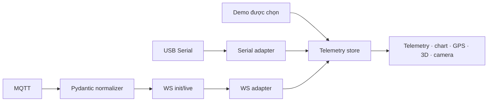

# Telemetry thống nhất — 15/10/2026

## Contract duy nhất

Model `TelemetryFrame` trong `fastapi-backend/app/models/telemetry.py` là nguồn định nghĩa. `scripts/export-telemetry-schema.py` sinh `shared/telemetry.schema.json` và `src/telemetry/frame.d.ts` từ model đó. Không chỉnh trực tiếp hai file sinh ra.

```powershell
npm run telemetry:schema
npm run telemetry:schema:check
```

Mỗi bản tin có `type: "telemetry"`, `schema_version: 1`, `device_id`, `source`, `timestamp`, `received_at`, `seq` và toàn bộ các trường đo bên dưới. Trường không có dữ liệu là **null**; không điền 0, tọa độ Hà Nội hay gia tốc 1g làm dữ liệu giả. Giá trị số 0 và boolean false được giữ nguyên.

| Trường | Đơn vị / ý nghĩa |
| --- | --- |
| `accX`, `accY`, `accZ` | g |
| `gyroX`, `gyroY`, `gyroZ` | độ/giây |
| `magX`, `magY`, `magZ` | µT |
| `temperatureC` | °C |
| `voltageV` | V |
| `humidityPct` | %RH, 0–100 |
| `pressureHpa` | hPa |
| `gpsLat`, `gpsLon` | độ, phạm vi ±90 / ±180 |
| `gpsAlt` | m |
| `uptimeMs` | ms từ lúc thiết bị khởi động |
| `ledOn` | boolean hoặc null |
| `imageData` | JPEG/PNG data URI, tối đa 60.000 ký tự, hoặc null |

`timestamp` là timestamp do nguồn gửi, tính bằng giây Unix hoặc null. Firmware dùng `millis()` phải gửi `uptime_ms`, không dùng nó như giờ UTC. `received_at` là giây Unix do backend/adapter Serial gán lúc nhận, dùng để đánh giá freshness. Đồng hồ thiết bị không quyết định stale. Không tự suy đoán/chuyển đổi đơn vị của firmware: các tên legacy bên dưới được hiểu theo đơn vị canonical trong bảng; firmware cần đổi m/s² sang g, Pa sang hPa hoặc rad/s sang độ/s trước khi gửi nếu dùng các đơn vị khác.

## Adapters và nguồn



- Serial chỉ nhận RX từ reader USB thật (`origin: serial`), không nhận log compiler/app dù log có nhãn RX. Bản tin được parse đúng một lần trong `TelemetryProvider`, hỗ trợ JSON một dòng và ảnh `IMG:<base64>`/JPEG-PNG data URI. Boot log, JSON không phải telemetry, số không hữu hạn/chuỗi số và bản tin sai UID bị bỏ qua.
- Các alias cũ được hỗ trợ: `acc_x/gyro_x/mag_x`, nested `acc/gyro/mag`, `battery_v`, `temp/temp_c/temperature`, `humidity`, `pressure/baro_hpa`, `lat/lng/lon/alt`, nested `gps`, `uptime_ms`, `led_on`.
- Nested field có mặt được ưu tiên, kể cả null; nếu không có field nested mới fallback flat. Alias có mặt trước trong adapter được ưu tiên. `shared/telemetry.examples.json` được kiểm tra ở cả Python và JavaScript để tránh hai phía chuẩn hóa khác nhau.
- Heartbeat Lab1 được giữ như uptime/LED trong frame; không được biến thành số đo cảm biến. Dòng Serial gốc vẫn có trong Serial Monitor.
- WS nhận đúng schema version 1 cho cả frame live và envelope `{ "type": "init", "device": <frame> }`. Cache cũ giữ `received_at` gốc nên không biến thành mẫu mới khi reconnect.
- Demo dùng một generator chung, 5 Hz, chỉ chạy khi chọn Demo. Không có timer demo riêng trong chart/GPS/3D/telemetry.

| Lựa chọn UI | Transport | `source` chấp nhận |
| --- | --- | --- |
| USB Serial | Cổng USB của trình duyệt | hardware |
| WebSocket · thiết bị thật | WS có JWT, thiết bị thuộc user | hardware |
| WebSocket · simulator | WS có JWT, thiết bị thuộc user | simulator |
| Demo | Generator local, UID demo | demo |

USB mặc định tự học UID đầu tiên nếu firmware gửi `device_id`; khi chưa có UID thì dùng `serial-local`. Có thể bind USB vào UID đã đăng ký để bỏ bản tin sai thiết bị. Đổi cổng/kết nối USB mới reset session. Nguồn WS cần đăng nhập và chọn thiết bị từ `/api/devices`. Chọn simulator không tự tạo/chạy session mô phỏng; cần simulator backend đang phát bản tin có source simulator cho UID đã chọn.

`VITE_WS_URL` tùy chọn là base URL tới `/ws` trên cùng backend xác thực; mặc định dùng origin hiện tại và Vite proxy. JWT không được hiển thị trong UI và bị loại khỏi URL log Uvicorn tại handshake.

## Session, stale và offline

Đổi nguồn, thiết bị hoặc tài khoản sẽ xóa latest/history và tăng generation. Callback Serial/WS/REST còn sót từ generation cũ không được ghi vào nguồn mới. Demo không tự bật khi mất USB hoặc WS.

- **Offline:** transport chưa kết nối hoặc đã mất kết nối. Mẫu cuối của cùng session được giữ và làm mờ.
- **Chờ dữ liệu:** transport đã mở, chưa có mẫu trong 5 giây đầu.
- **Đang nhận:** có frame hợp lệ, receive age không quá 5 giây.
- **Stale:** transport còn mở nhưng không có mẫu mới quá 5 giây; hoặc nhận cache đã cũ. UI hiển thị receive age.

WS bootstrap qua REST (timeout 10 giây) để kiểm tra quyền, rồi mở socket cho đúng UID. Mất mạng thử lại sau 1 giây, backoff tối đa 10 giây; 401/403/404 hoặc close policy 1008 dừng retry. Ping mỗi 10 giây giúp backend kiểm tra lại phiên/quyền, nhưng ping không làm telemetry trở thành fresh. Cleanup đóng socket/timer và hủy fetch khi đổi selection.

USB chỉ có một provider; reader/writer/pipeline được giải phóng khi ngắt, port đóng hoặc lỗi đọc. Dòng Serial tối đa 64 KiB; raw log giữ 500 dòng. Telemetry history giữ 200 frame, camera gallery tối đa 10 ảnh, raw packet panel hiển thị 10 frame gần nhất.

3D chỉ dùng pose suy ra từ store. Roll/pitch ưu tiên gia tốc; gyro tích phân theo chênh lệch receive time thực, không tích phân qua khoảng trống >1 giây. Yaw là góc tương đối, không phải hướng Bắc tuyệt đối. Heartbeat không làm pose IMU cũ thành fresh; thẻ 3D có nhãn IMU stale riêng.

Các widget hiện cùng nguồn: TelemetryPanel, VoltageChart, EnvironmentPanel, GPSMap, AttitudeViewer3D, CameraViewer và gauge/alert dashboard. Lệnh uplink chỉ gửi khi chọn USB Serial và USB đang nối; demo/WS không gửi lệnh sang cổng USB ngoài ý muốn. System Check chỉ có dữ liệu minh họa khi nguồn Demo được chọn và không khẳng định thành công khi thiếu phản hồi.

## Kiểm chứng

```powershell
npm run check
npm run build
```

Kiểm thử frontend bao gồm zero/null, alias, schema invalid, UID/source mismatch, nguồn đổi nhanh, callback muộn, frame cache cũ, stale/offline, history bounded, sequence restart, reconnect và auth denial. Backend kiểm tra shared fixtures, strict numbers và bản tin WS init/live. Đã QA trình duyệt: demo chỉ xuất hiện khi chọn; đổi về USB reset bộ đếm và số liệu; không có lỗi console.

Chưa kiểm tra USB/ESP32 vật lý hoặc MQTT broker thật trong đợt này. Các kiểm thử transport dùng socket/stream mô phỏng hoặc ASGI WebSocket thật trong test, không chứng minh cảm biến phần cứng đã được hiệu chuẩn.
