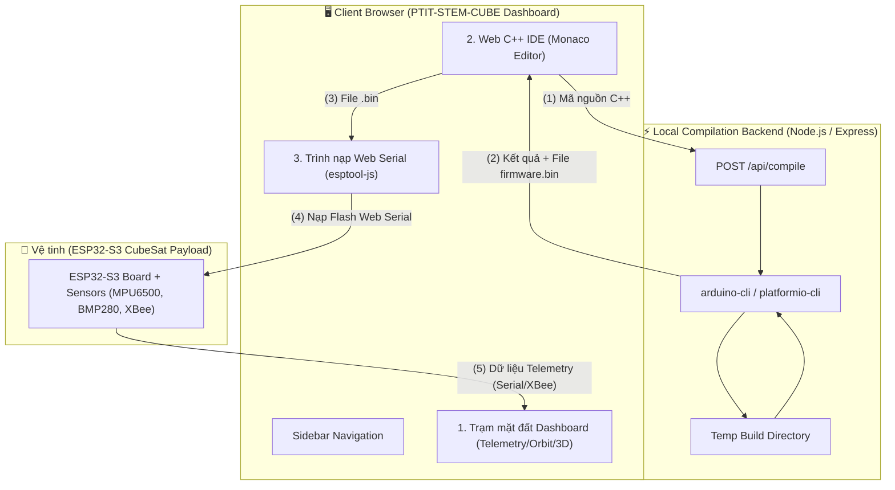

# 🛰️ PTIT-STEM-CUBE & CUBESAT SYSTEM ARCHITECTURE PLAN (V2.0)

> **Mô hình tổng thể:** Hệ thống được chia làm 2 phân hệ độc lập nhưng tích hợp chặt chẽ:
> 1. **Phân hệ 1: Trạm mặt đất (Ground Station Dashboard)** — *Đã hoàn thành & Hoạt động ổn định*.
> 2. **Phân hệ 2: Trình biên dịch C++ & Web IDE Nạp code Vệ tinh (CubeSat System)** — *Tích hợp Backend biên dịch & Monaco Editor Web IDE*.

---

## 🏗️ 1. TỔNG QUAN KIẾN TRÚC HỆ THỐNG V2

---

## 📦 2. CHI TIẾT CÁC PHÂN HỆ

### Phân hệ 1: Trạm Mặt Đất (Ground Station Dashboard)
*   **Trạng thái:** *Hoàn thành 100% (Giữ nguyên không cần sửa đổi).*
*   **Tính năng chính:**
    *   Giám sát cảm biến 60 FPS (Gia tốc, Con quay, Từ trường, Nhiệt độ, Điện áp).
    *   Bản đồ quỹ đạo vệ tinh 2D tỷ lệ 2:1 tích hợp thuật toán SGP4.
    *   Mô phỏng ăng-ten xoay 3D (Three.js / React Three Fiber).
    *   Terminal phản hồi Serial ASCII/HEX và phím tắt macro.
    *   Trình nạp firmware đa file nhị phân qua Web Serial API.

---

### Phân hệ 2: Web C++ IDE & Backend Biên Dịch (CubeSat Firmware System)

#### 2.1 Backend Biên Dịch C++ (`cube-compiler-backend`)
*   **Công nghệ:** Node.js (Express) hoặc Python (FastAPI).
*   **Công cụ biên dịch ngầm:** `arduino-cli` (với core `esp32:esp32` đã cài sẵn) hoặc `platformio-cli`.
*   **Cấu trúc API Endpoint:**
    *   `GET /api/health`: Kiểm tra trạng thái hoạt động của trình biên dịch `arduino-cli`.
    *   `POST /api/compile`:
        *   **Input Payload:** `{ code: string, board: "esp32s3" }`
        *   **Quy trình xử lý:**
            1. Lưu đoạn code C++ vào thư mục tạm `scratch/build_XXXX`.
            2. Gọi lệnh `arduino-cli compile --fqbn esp32:esp32:esp32s3 ...` ngầm.
            3. Thu thập thông báo lỗi (Compiler Errors/Warnings) hoặc dung lượng RAM/Flash.
            4. Mã hóa file `firmware.bin` sinh ra thành chuỗi Base64.
        *   **Output Payload:** `{ success: true, binBase64: "...", logs: "...", flashBytes: 124500 }` hoặc `{ success: false, errors: "..." }`.

#### 2.2 Trình Soạn Thảo Web C++ IDE (`src/components/WebCodeEditor.tsx`)
*   **Trình chỉnh sửa mã:** `@monaco-editor/react` (lõi soạn thảo mã nguồn của VS Code).
*   **Tính năng IDE trên Web:**
    *   Tô màu cú pháp C++ (Syntax Highlighting), hiển thị số dòng, tự động hoàn thành từ khóa (Autocomplete).
    *   **Bộ Mẫu Code (Code Templates Dropdown):** Nút chọn nhanh các mẫu code chuẩn cho vệ tinh:
        1. *01_Blink_LED.cpp* (Kiểm tra mạch).
        2. *02_MPU6500_IMU.cpp* (Đọc gia tốc & góc nghiêng).
        3. *03_BMP280_Altitude.cpp* (Đọc áp suất & độ cao).
        4. *04_Full_CubeSat_Telemetry.cpp* (Mã nguồn hoàn chỉnh phát gói tin cho Trạm mặt đất).
    *   **Cửa sổ Compiler Terminal:** Hiển thị thông báo tiến trình biên dịch, lỗi cú pháp theo từng dòng (Line-by-line error positioning).
    *   **Nút "Biên dịch & Nạp 1-Click":** Nhấn 1 nút để tự động gửi code đi biên dịch -> nhận file `.bin` -> gọi `esptool-js` nạp trực tiếp qua Web Serial vào ESP32-S3!

---

## 🗓️ 3. DẠNG LỘ TRÌNH TRIỂN KHAI PHÂN HỆ 2 (ROADMAP)

### Giai đoạn 1: Cấu hình Compiler Backend (`cube-compiler-backend`)
- [ ] Cài đặt `arduino-cli` và cài package core `esp32:esp32` (hoặc `esp32s3`).
- [ ] Khởi tạo dự án Express Node.js nhỏ (`server.js`) xử lý Endpoint `POST /api/compile`.
- [ ] Kiểm tra khả năng biên dịch file `main.cpp` ra `firmware.bin` và trả về Base64.

### Giai đoạn 2: Tích hợp Monaco Editor Web IDE vào Frontend
- [ ] Cài đặt thư viện `@monaco-editor/react` vào dự án `PTIT-STEM-CUBE`.
- [ ] Tạo linh kiện `src/components/WebCodeEditor.tsx` với giao diện kính mờ dark-tech.
- [ ] Bổ sung thanh chọn Code mẫu (Templates Dropdown) và Compiler Log Terminal.

### Giai đoạn 3: Kết nối Luồng Biên dịch 1-Click (1-Click Compile & Flash)
- [ ] Kết nối nút **"Biên dịch C++"** từ Frontend gửi code tới `POST /api/compile`.
- [ ] Chuyển đổi dữ liệu Base64 nhận được thành `Uint8Array`.
- [ ] Truyền trực tiếp mảng byte vào `esptool-js` để nạp ngay vào chip ESP32-S3 qua Web Serial mà không cần lưu thủ công ra ổ cứng.

### Giai đoạn 4: Kiểm thử End-to-End (E2E Verification)
- [ ] Viết code thử nghiệm trên Web IDE -> Biên dịch ngầm -> Nạp vào ESP32-S3 -> Chuyển sang tab Telemetry xem đồ thị chạy real-time.

---

## 💡 4. ĐÁNH GIÁ TÍNH KHẢ THI & BẢO MẬT
1. **Bảo mật Sandbox:** Quá trình biên dịch backend chạy trong thư mục tạm isolated, giới hạn thời gian thực thi tối đa 30 giây tránh treo server.
2. **Tốc độ biên dịch:** Lần biên dịch đầu tiên mất khoảng 5-10s (để nạp thư viện), các lần sau nhờ cơ chế caching của `arduino-cli` chỉ mất từ 1-2 giây.
3. **Trải nghiệm người dùng:** Học sinh/sinh viên chỉ cần mang mạch ESP32-S3 cắm vào máy tính, mở trình duyệt web là có thể vừa lập trình C++, vừa nạp code, vừa xem đồ thị 3D mà không cần cài đặt phần mềm nặng như Arduino IDE hay VS Code PlatformIO.
