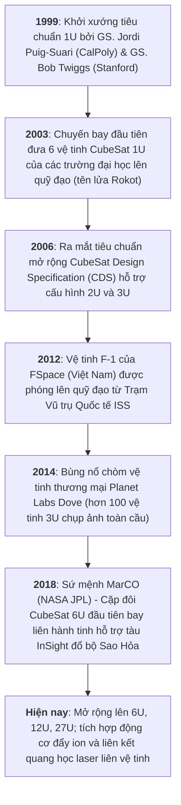
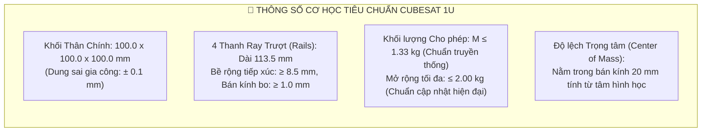
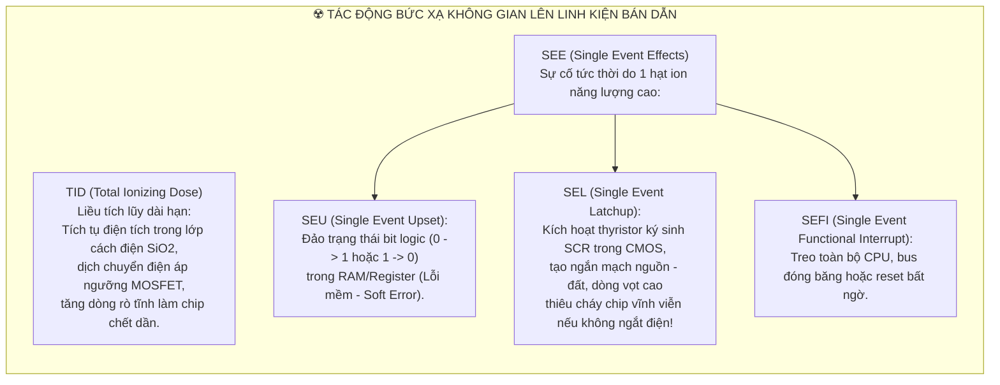
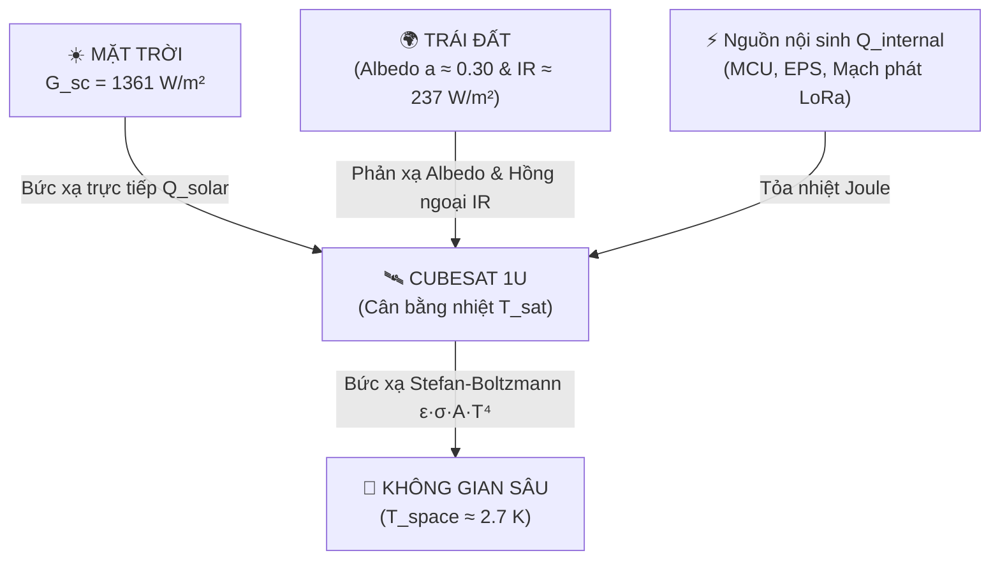

# Doc 0.1: Lịch sử CubeSat, Tiêu chuẩn Kỹ thuật & Môi trường Quỹ đạo LEO

### 1. Lịch sử Phát triển và Triết lý Tiêu chuẩn Hóa CubeSat
Vệ tinh siêu nhỏ tiêu chuẩn **CubeSat** được khởi xướng vào năm 1999 thông qua sự hợp tác lịch sử giữa Giáo sư **Jordi Puig-Suari** (Đại học Bách khoa Bang California - CalPoly, San Luis Obispo) và Giáo sư **Bob Twiggs** (Đại học Stanford). Mục tiêu nguyên bản của dự án là thiết lập một tiêu chuẩn kích thước và giao diện cơ khí đồng nhất, giúp sinh viên đại học có thể tự tay thiết kế, chế tạo, thử nghiệm và vận hành một vệ tinh nhân tạo thực thụ trong khoảng thời gian phù hợp với chu kỳ đào tạo (1 - 2 năm) với ngân sách chỉ bằng một phần nghìn so với các vệ tinh truyền thống.

Trước khi CubeSat ra đời, ngành công nghiệp vũ trụ bị chi phối bởi các vệ tinh lớn có khối lượng từ vài trăm kilogam đến hàng tấn, chi phí phát triển lên tới hàng trăm triệu USD và thời gian chuẩn bị kéo dài hàng thập kỷ. Bất kỳ một sai sót nhỏ nào cũng dẫn đến thiệt hại khổng lồ, khiến các kỹ sư có xu hướng cực kỳ bảo thủ, chỉ sử dụng các linh kiện điện tử chuyên dụng chống bức xạ (Radiation-Hardened) thế hệ cũ và đắt đỏ. 

CubeSat đã tạo nên một cuộc cách mạng mang tính đột phá (New Space Revolution) dựa trên ba trụ cột triết lý cốt lõi:
1. **Tiêu chuẩn Hóa Cơ khí & Giao diện Phóng (Standardized Form Factor & Deployment):** Quy định kích thước khối lập phương cố định giúp các nhà cung cấp tên lửa đẩy dễ dàng tích hợp vệ tinh vào các khoang chứa tiêu chuẩn mà không cần thiết kế lại cơ cấu gá phóng cho từng sứ mệnh.
2. **Khai thác Linh kiện Thương mại Sẵn có (COTS - Commercial Off-The-Shelf):** Tận dụng bước nhảy vọt của ngành công nghiệp bán dẫn tiêu dùng (vi xử lý ARM/ESP32, cảm biến MEMS, pin Lithium-Ion điện thoại). Mặc dù linh kiện COTS không được bọc chắn bức xạ chuyên dụng, các kỹ sư vũ trụ hiện đại áp dụng các giải pháp kiến trúc hệ thống, thuật toán tự sửa lỗi và cơ chế dự phòng đa tầng để đạt độ tin cậy bay mong muốn với giá thành cực thấp.
3. **Đóng gói Kín Giảm Thiểu Rủi ro cho Tên lửa Mẹ (Containerized Launch Integration):** Vệ tinh được nhốt hoàn toàn bên trong ống phóng dạng hộp kín có nắp đậy (như P-POD). Mọi nguy cơ bung vỡ chi tiết, đoản mạch hay phát sóng ngoài ý muốn đều bị cô lập hoàn toàn, bảo vệ an toàn tuyệt đối cho tên lửa đẩy và tải trọng thương mại chính.



---

### 2. Phân loại Vệ tinh Nhỏ (SmallSat) theo Khối lượng
Trong thang phân loại quốc tế của Liên đoàn Hàng không Vũ trụ Quốc tế (IAF) và NASA, các vệ tinh nhỏ (SmallSat) được định danh chính xác dựa trên khối lượng ướt khi phóng (Wet Mass bao gồm cả nhiên liệu nếu có):

| Nhóm Vệ tinh | Khối lượng Phóng ($M$) | Ví dụ Điển hình & Cấu hình CubeSat |
| :--- | :--- | :--- |
| **Minisatellite (Vệ tinh nhỏ)** | $100\text{ kg} \le M < 500\text{ kg}$ | Vệ tinh viễn thám cao cấp, chòm vệ tinh Starlink v1 |
| **Microsatellite (Vệ tinh siêu nhỏ)** | $10\text{ kg} \le M < 100\text{ kg}$ | Vệ tinh VNREDSat-1 (115 kg), CubeSat 12U - 27U |
| **Nanosatellite (Vệ tinh nano)** | $1\text{ kg} \le M < 10\text{ kg}$ | **Chuẩn CubeSat tiêu chuẩn: 1U (1.33 kg), 2U, 3U, 6U** |
| **Picosatellite (Vệ tinh pico)** | $0.1\text{ kg} \le M < 1\text{ kg}$ | Vệ tinh dạng bản mạch PocketQube (5 × 5 × 5 cm), Chipsat |
| **Femtosatellite (Vệ tinh femto)** | $M < 0.1\text{ kg}$ ($< 100\text{ g}$) | Vệ tinh vi mạch đơn màng mỏng (Sprite, KickSat) |

---

### 3. Thông số Hình học Tiêu chuẩn 1U (1 Unit) theo Quy chuẩn CalPoly
Một vệ tinh CubeSat đơn vị cơ sở (1U) phải tuân thủ nghiêm ngặt các quy định kích thước trong tài liệu đặc tả **CubeSat Design Specification (CDS)** do Đại học CalPoly ban hành để đảm bảo vệ tinh có thể trượt vừa vặn trơn tru bên trong ống phóng mà không bao giờ bị kẹt:



| Thông số Kỹ thuật | Tiêu chuẩn Quy định | Ý nghĩa Kỹ thuật & Dung sai Kiểm định |
| :--- | :--- | :--- |
| **Kích thước Thân cơ sở ($X \times Y$)** | 100.0 × 100.0 mm | Dung sai cực kỳ nghiêm ngặt ±0.1 mm; kiểm tra bằng dưỡng đo cơ khí (Go/No-Go Gauge). |
| **Chiều dài Dọc trục Ray ($Z$)** | 113.5 mm | Tính từ mặt phẳng đáy ray đến đỉnh ray. Các thanh ray nhô ra 6.5 mm ở mỗi đầu để ngăn các mặt bên chạm đáy. |
| **Bề rộng Thanh ray (Rails)** | Tối thiểu 8.5 mm | Tiếp xúc trực tiếp với rãnh dẫn hướng của ống phóng POD để chịu tải trọng rung động. |
| **Bán kính Bo viền Ray** | Tối thiểu 1.0 mm | Bán kính lượn góc nhẵn bóng nhằm loại bỏ hoàn toàn các gờ sắc nhọn gây cào xước ống phóng. |
| **Độ nhám Bề mặt Ray ($R_a$)** | $R_a \le 0.8\text{ }\mu\text{m}$ | Bề mặt ray trượt phải được mài bóng kỹ thuật cao để giảm thiểu lực ma sát trượt khi bung. |
| **Xử lý Bề mặt Ray (Hard Anodize)** | Anodize Cứng Type III | Tạo lớp gốm oxit nhôm dày ($25 - 50\text{ }\mu\text{m}$) cách điện, chống mài mòn và chống hàn nguội trong chân không. |
| **Vùng Cấm Nhô (Keep-out Zone)** | Tối đa 6.5 mm | Không có bất kỳ linh kiện, đầu ốc vít hay thấu kính nào được nhô ra khỏi bề mặt ngoài vượt quá 6.5 mm. |
| **Vị trí Trọng tâm (CoM)** | Cách tâm hình học ≤ 20 mm | Phân bố khối lượng lệch tâm vượt chuẩn sẽ tạo mô-men xoắn gây rung lắc ống phóng và kẹt khi đẩy. |

---

### 4. Cơ chế Phóng P-POD & J-SSOD
CubeSat không được gắn trực tiếp lên tên lửa đẩy mà bắt buộc phải nằm trong một hệ thống phóng dạng hộp kín chuyên dụng:
1. **P-POD (Poly-Picosatellite Orbital Deployer):** Phát triển bởi CalPoly, là ống phóng kinh điển bằng hợp kim nhôm Al 7075-T6. Một ống P-POD tiêu chuẩn có thể chứa một vệ tinh 3U hoặc ba vệ tinh 1U xếp chồng nối tiếp nhau.
2. **J-SSOD (JEM Small Satellite Orbital Deployer):** Hệ thống phóng vệ tinh lắp đặt trên Module Kibo của Nhật Bản thuộc Trạm Vũ trụ Quốc tế ISS. Các phi hành gia đưa bộ phóng ra ngoài không gian qua cửa điều áp (Air Lock) và cánh tay robot Kibo sẽ định hướng ống phóng về phía sau quỹ đạo ISS để đẩy CubeSat ra ngoài.

```mermaid
sequenceDiagram
    autonumber
    participant Rocket as Tên lửa Đẩy / Trạm ISS
    participant Deployer as Ống phóng POD (P-POD / J-SSOD)
    participant CubeSat as Vệ tinh CubeSat 1U
    participant Space as Không gian Quỹ đạo LEO

    Rocket->>Deployer: Gửi xung điện kích hoạt nhả chốt cửa (NEA)
    Deployer->>Deployer: Mở nắp cửa ống phóng; giải phóng lò xo đẩy chính
    Deployer->>CubeSat: Lò xo đáy tạo xung lực đẩy dọc thanh ray (Vận tốc thoát: 1.0 - 1.5 m/s)
    CubeSat->>Space: Tách ly hoàn toàn khỏi ống phóng vào quỹ đạo tự do
    CubeSat->>CubeSat: Công tắc hành trình (Deployment Switch) bật lên: Cấp nguồn cho bo EPS
    CubeSat->>CubeSat: Bắt đầu đếm ngược thời gian im lặng vô tuyến bắt buộc (30 phút)
```

- **Lò xo đẩy chính (Ejection Spring):** Đặt tại đáy ống phóng, cung cấp lực đẩy tuyến tính ổn định để phóng vệ tinh với vận tốc tương đối từ 1.0 m/s đến 1.5 m/s, tránh nguy cơ vệ tinh bay lơ lửng ngay cửa ống gây va chạm với tên lửa.
- **Lò xo tách tầng (Deployment Plungers):** Lắp ở đỉnh các thanh ray trượt. Khi hai vệ tinh CubeSat xếp chồng trong cùng một ống phóng rời khỏi cửa, các lò xo plunger nhỏ sẽ lập tức đẩy hai vệ tinh dạt xa nhau để ngăn ngừa va chạm thứ cấp.
- **Công tắc Hành trình Phóng (Deployment Switch / Inhibit Switch):** Lắp ở chân thanh ray trượt. Khi vệ tinh nằm trong ống phóng, nắp hoặc ray đè chặt công tắc ở trạng thái ngắt mạch điện (Open circuit). Khi vệ tinh vừa trượt ra ngoài không gian, công tắc bung ra, đóng mạch điện kết nối pin sạc với hệ thống phân phối nguồn EPS.
- **Quy tắc Im lặng Vô tuyến 30 Phút (30-Minute Radio Silence Rule):** Theo yêu cầu an toàn phóng quốc tế của CalPoly, NASA và JAXA, CubeSat **bắt buộc phải giữ im lặng vô tuyến hoàn toàn trong ít nhất 30 phút đầu tiên** sau khi rời ống phóng. Trong khoảng thời gian này, vi điều khiển không được phát sóng radio, không được kích hoạt đốt nhiệt bung anten hay mở các tấm pin để tránh gây nhiễu cho các thiết bị điều khiển của tên lửa đẩy và các vệ tinh khác phóng cùng cụm.

---

### 5. Môi trường Vật lý Khắc nghiệt tại Quỹ đạo Trái Đất Tầm thấp (LEO)
Quỹ đạo LEO (Low Earth Orbit) nằm ở độ cao từ 160 km đến 2000 km so với mực nước biển (phổ biến nhất cho CubeSat là 400 - 600 km, tương đương quỹ đạo trạm ISS $~410\text{ km}$). Môi trường không gian tại đây đặt ra những thử thách kỹ thuật cực đoan:

#### A. Môi trường Chân không Cực cao (Ultra-High Vacuum)
Áp suất khí quyển tại độ cao 500 km suy giảm xuống chỉ còn khoảng 10⁻⁶ Pa đến 10⁻⁸ Pa (10⁻⁸ - 10⁻¹⁰ Torr), so với áp suất khí quyển tiêu chuẩn tại mặt đất là 101.325 kPa (760 Torr):
- **Triệt tiêu Hoàn toàn Truyền nhiệt Đối lưu:** Định luật làm mát đối lưu Fourier/Newton $\dot{Q} = h A (T_s - T_\infty)$ hoàn toàn biến mất do không có phân tử khí chuyển động tự do. Toàn bộ nhiệt lượng sinh ra từ CPU, mạch sạc pin và máy phát sóng chỉ có thể:
  1. Dẫn nhiệt (**Conduction**) qua đồng của bo mạch in PCB và khung kim loại nhôm.
  2. Bức xạ nhiệt (**Radiation**) từ bề mặt ngoài của thân vệ tinh vào không gian sâu.
- **Hiện tượng Thoát khí Vật liệu (Outgassing):** Dưới áp suất chân không cực thấp, các hợp chất hữu cơ dễ bay hơi, dung môi tồn dư, chất hóa dẻo trong polyme, băng keo và chất cách điện sẽ thoát ra khỏi bề mặt vật liệu. Các hạt khí này bay lơ lửng và nhanh chóng ngưng tụ lạnh lên bề mặt quang học của ống kính camera làm mờ đục ảnh chụp, hoặc phủ lên tế bào quang điện làm sụt giảm công suất sạc. Tiêu chuẩn **ASTM E595** của NASA quy định vật liệu không gian phải đạt:
$$\text{TML (Total Mass Loss)} \le 1.0\%, \quad \text{CVCM (Collected Volatile Condensable Material)} \le 0.1\%$$
- **Hiện tượng Hàn nguội Chân không (Cold Welding):** Trong không khí mặt đất, bề mặt kim loại luôn được bao phủ bởi một màng oxit mỏng tự nhiên và lớp phân tử ẩm. Trong môi trường chân không sâu, lớp oxit này bị triệt tiêu hoặc mài mòn. Khi hai bề mặt kim loại trần cùng loại (nhất là nhôm hoặc thép không gỉ) tiếp xúc trực tiếp dưới lực siết mạnh, các mạng tinh thể kim loại sẽ liên kết tự do, dính chặt vào nhau như được hàn nóng chảy. Đây là lý do các thanh ray CubeSat bắt buộc phải mạ **Anodize cứng Type III** (lớp gốm Al₂O₃ siêu cứng ngăn cách tiếp xúc kim loại trực tiếp).

#### B. Môi trường Bức xạ Vũ trụ & Hạt Mang điện Năng lượng Cao
Không gian LEO không được tầng khí quyển dày bảo vệ hoàn toàn, vệ tinh liên tục bị bắn phá bởi các chùm hạt proton từ gió Mặt Trời, tia vũ trụ ngân hà (Galactic Cosmic Rays - GCR) và các điện tử bị bẫy trong hai vành đai bức xạ Van Allen:



- **Giải pháp Giảm nhẹ trên CubeSat:**
  - Sử dụng mạch giám sát dòng điện tức thời trên chip EPS để phát hiện SEL và ngắt nguồn cưỡng bức (Power Cycling) trong vài mili-giây trước khi chip bị phá hủy vì nhiệt.
  - Sử dụng bộ định thời Watchdog Timer phần cứng độc lập (**Hardware Watchdog Timer**) để tự động khởi động lại OBC khi gặp lỗi treo phần mềm hoặc SEFI.
  - Sử dụng mã sửa sai Hamming / ECC (Error-Correcting Code) và thuật toán lưu trữ dự phòng ba lần (**TMR - Triple Modular Redundancy**) trong bộ nhớ để sửa lỗi lật bit SEU.

#### C. Khí Oxy Nguyên tử (Atomic Oxygen - AO)
Ở độ cao 200 - 600 km, bức xạ cực tím tử ngoại (UV) năng lượng cao từ Mặt Trời bẻ gãy các liên kết phân tử oxy hai nguyên tử (O₂) trong tầng nhiệt khí quyển thành các gốc **oxy nguyên tử tự do ($O$)**. Khi vệ tinh bay với vận tốc quỹ đạo siêu thanh ~7.7 km/s, các nguyên tử oxy này va chạm trực diện với bề mặt đón gió của vệ tinh với động năng khoảng 5 eV. Khí oxy nguyên tử có tính oxy hóa cực mạnh, ăn mòn nhanh chóng các bề mặt mạ bạc, ăn mòn polyme Kapton và phá hủy các lớp phủ quang học.

#### D. Cân bằng Nhiệt Quỹ đạo (Thermal Equilibrium in Space)
Nhiệt độ của CubeSat trong không gian là kết quả của sự cân bằng động học giữa tổng công suất nhiệt hấp thụ và tổng công suất nhiệt bức xạ ra vũ trụ:

$$\dot{Q}_{\text{in}} + Q_{\text{internal}} = \dot{Q}_{\text{out}}$$

Trong đó:
1. **Nhiệt Hấp thụ ($\dot{Q}_{\text{in}}$):**
   - **Bức xạ Mặt Trời Trực tiếp ($Q_{\text{solar}}$):** Hằng số Mặt Trời tại quỹ đạo Trái Đất $G_{sc} \approx 1361\text{ W/m}^2$. Công suất hấp thụ:
$$Q_{\text{solar}} = \alpha \cdot A_{\text{proj}} \cdot G_{sc}$$
     (với $\alpha$ là hệ số hấp thụ quang học của bề mặt vỏ, $A_{\text{proj}}$ là diện tích hình chiếu vuông góc với tia nắng).
   - **Bức xạ Phản xạ từ Trái Đất (Earth Albedo - $Q_{\text{albedo}}$):** Trái Đất phản xạ lại không gian trung bình khoảng 30% ($a \approx 0.30$) thông lượng ánh sáng Mặt Trời:
$$Q_{\text{albedo}} = \alpha \cdot A_{\text{earth}} \cdot G_{sc} \cdot a \cdot F_{\text{sat-earth}}$$
   - **Bức xạ Hồng ngoại Phát ra từ Trái Đất (Earth Infrared - $Q_{\text{IR}}$):** Bản thân Trái Đất phát xạ nhiệt hồng ngoại như một vật đen ở nhiệt độ ~255 K, với thông lượng trung bình $q_{\text{IR}} \approx 237\text{ W/m}^2$:
$$Q_{\text{IR}} = \varepsilon \cdot A_{\text{earth}} \cdot q_{\text{IR}} \cdot F_{\text{sat-earth}}$$
2. **Nhiệt Nội sinh ($Q_{\text{internal}}$):** Công suất tiêu tán nhiệt từ các linh kiện điện tử đang hoạt động (CPU OBC, mạch sạc pin EPS, mạch khuếch đại công suất PA của module truyền thông LoRa).
3. **Nhiệt Bức xạ ra Không gian Sâu ($\dot{Q}_{\text{out}}$):** Theo định luật bức xạ vật đen **Stefan-Boltzmann**:
$$\dot{Q}_{\text{out}} = \varepsilon \cdot \sigma \cdot A_{\text{total}} \cdot (T_{\text{sat}}^4 - T_{\text{space}}^4)$$
   (với $\varepsilon$ là hệ số phát xạ hồng ngoại của vật liệu vỏ, hằng số Stefan-Boltzmann $\sigma = 5.67 \times 10^{-8}\text{ W/(m}^2\text{K}^4)$, $A_{\text{total}}$ là tổng diện tích bức xạ $6$ mặt của CubeSat, T_space ≈ 2.7 K ≈ -270.45°C).



- **Biên độ Biến thiên Nhiệt:**
  - **Pha Ban ngày (Sunlight):** Vệ tinh hấp thụ nhiệt mặt trời tối đa, nhiệt độ bề mặt ngoài có thể tăng vọt lên +80°C đến +100°C.
  - **Pha Vùng tối (Eclipse):** Khi vệ tinh đi vào vùng khuất bóng của Trái Đất (≈ 35 phút mỗi vòng bay), $Q_{\text{solar}} = 0$ và $Q_{\text{albedo}} = 0$, vệ tinh liên tục mất nhiệt vào vũ trụ, nhiệt độ vỏ tụt dốc xuống -40°C đến -50°C.
  - Trung bình mỗi ngày vệ tinh trải qua $15 - 16$ chu kỳ sốc nhiệt nóng - lạnh cực đoan, đòi hỏi thiết kế nhiệt thụ động (**Passive Thermal Control**) bằng cách tính toán tỷ số $\alpha/\varepsilon$ của các lớp phủ bề mặt (như băng keo Kapton, mạ niken hoặc sơn anodize đen).

#### E. Động học Quỹ đạo & Thời gian Suy thoái (Orbital Decay)
1. **Vận tốc Quỹ đạo Cân bằng (Orbital Velocity):**
   Vệ tinh duy trì quỹ đạo tròn khi lực hấp dẫn cân bằng hoàn toàn với lực hướng tâm:
$$\frac{G M_E m}{(R_E + h)^2} = \frac{m v^2}{R_E + h} \implies v = \sqrt{\frac{G M_E}{R_E + h}} = \sqrt{\frac{\mu}{r}}$$
   Với hằng số hấp dẫn Trái Đất $\mu = G M_E \approx 398600.44\text{ km}^3/\text{s}^2$, bán kính Trái Đất $R_E \approx 6378.14\text{ km}$. Ở độ cao $h = 500\text{ km}$:
$$v = \sqrt{\frac{398600.44}{6378.14 + 500}} \approx 7.613\text{ km/s} \approx 27400\text{ km/h}$$
2. **Chu kỳ Quỹ đạo (Orbital Period):**
$$T = 2\pi \sqrt{\frac{(R_E + h)^3}{\mu}} = 2\pi \sqrt{\frac{(6878.14)^3}{398600.44}} \approx 5677\text{ s} \approx 94.6\text{ min}$$
   Trong một ngày đêm Trái Đất (24 giờ), vệ tinh hoàn thành:
$$N = \frac{24 \times 60}{94.6} \approx 15.22\text{ orbits/day}$$
3. **Lực Cản Khí quyển & Quy tắc 25 Năm (IADC 25-Year Rule):**
   Mặc dù rất loãng, tầng khí quyển tàn dư vẫn tạo ra lực cản khí động học:
$$F_{\text{drag}} = \frac{1}{2} \rho v^2 C_d A$$
   (với $\rho$ là mật độ không khí, $C_d \approx 2.2$ là hệ số cản của khối lập phương, $A$ là diện tích cản gió). Lực cản này liên tục tiêu hao cơ năng của vệ tinh, làm độ cao quỹ đạo giảm dần (Orbital Decay) cho đến khi vệ tinh rơi vào tầng khí quyển dày và bốc cháy hoàn toàn:
   - Độ cao $< 200\text{ km}$ : Vệ tinh rơi và bốc cháy chỉ trong vài ngày.
   - Độ cao 300 - 400 km : Tuổi thọ quỹ đạo kéo dài vài tháng đến $1 - 2$ năm (quỹ đạo lý tưởng cho CubeSat giáo dục).
   - Độ cao 500 - 600 km : Tuổi thọ quỹ đạo từ $5$ đến $25$ năm.
   - Độ cao $> 800\text{ km}$ : Tồn tại hàng trăm năm, trở thành rác vũ trụ nguy hiểm nếu không có động cơ khử quỹ đạo.
   - **Quy chuẩn IADC / Liên Hợp Quốc:** Ủy ban Điều phối Rác Vũ trụ Quốc tế (IADC) quy định mọi vệ tinh LEO sau khi kết thúc sứ mệnh phải tự động khử quỹ đạo và bốc cháy trong vòng không quá **25 năm**. Vệ tinh cũng phải thực hiện quy trình **Thụ động hóa (Passivation)**: xả kiệt dung lượng pin sạc và giải phóng toàn bộ năng lượng dư thừa để tránh nguy cơ phát nổ tạo thành các mảnh vụn không gian.
