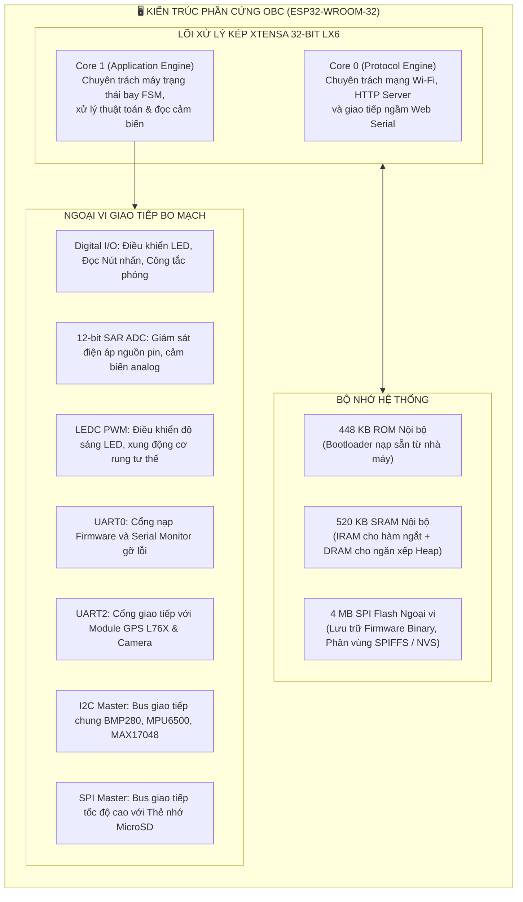
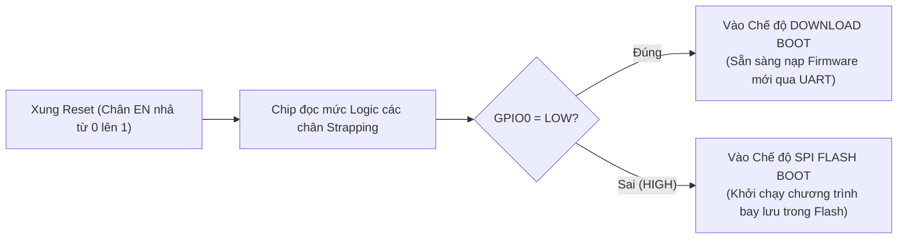

# Doc 1.1: Kiến trúc Phần cứng Vi điều khiển ESP32-WROOM-32 & Các Chuẩn Giao tiếp Ngoại vi

### 1. Vai trò Cốt tử của Phân hệ Máy tính trên Bo mạch (OBC - On-Board Computer)

Trong cấu trúc phân tầng của một vệ tinh nhân tạo CubeSat 1U, phân hệ Máy tính trên Bo mạch (**OBC - On-Board Computer**) đóng vai trò như "bộ não hạt nhân" chỉ huy, điều phối và liên kết toàn bộ các phân hệ chức năng khác thành một thực thể thống nhất. Nếu không có OBC hoạt động tin cậy, vệ tinh sẽ chỉ là một khối kim loại vô tri lơ lửng ngoài không gian.

Các nhiệm vụ sống còn mà OBC đảm nhiệm bao gồm:

1. **Khởi động & Quản lý Trình tự Nạp Hệ thống (Bootstrapping & Sequence Management):** Khi công tắc hành trình phóng nhả ra ngoài không gian, OBC khởi động từ bộ nhớ bất biến ROM/Flash, nạp cấu hình hệ thống, kiểm tra tính toàn vẹn của các ngoại vi và khởi chạy bộ đếm thời gian im lặng vô tuyến 30 phút.
2. **Thu thập & Đóng gói Dữ liệu Viễn trắc (Telemetry Acquisition & Framing):** Định kỳ quét và đọc các thông số từ phân hệ nguồn EPS (điện áp, dòng sạc/xả, dung lượng pin, nhiệt độ cell), phân hệ cảm biến (áp suất khí quyển, gia tốc, vận tốc góc quay, từ trường Trái Đất, tọa độ GPS) và trạng thái kết cấu để đóng gói thành bản tin nhị phân chuẩn (Beacon).
3. **Tiếp nhận & Thực thi Mệnh lệnh Điều khiển (Telecommand Processing):** Lắng nghe dữ liệu gói tin từ trạm mặt đất chuyển tiếp qua phân hệ truyền thông COM, giải mã cú pháp mệnh lệnh (Opcode, Payload), xác thực khóa bản quyền bảo mật (Security Token) và thực thi các hành động như: kích hoạt camera chụp ảnh, thay đổi chu kỳ phát beacon, bật/tắt nguồn cảm biến hoặc nạp lại tham số quỹ đạo.
4. **Quản lý Hệ thống Tệp tin & Lưu trữ Dữ liệu Bay (Data Storage & File Management):** Quản lý quá trình ghi tệp dữ liệu cảm biến, hình ảnh viễn thám và nhật ký hành trình bay (Flight Log) lên thẻ nhớ microSD qua giao diện SPI tốc độ cao định dạng FAT32.
5. **Giám sát Trạng thái & Tự động Phục hồi Lỗi (FDIR - Fault Detection, Isolation, and Recovery):** Theo dõi nhịp tim hệ thống (Heartbeat), duy trì xung làm tươi bộ định thời Watchdog Timer phần cứng (Hardware Watchdog Timer) và kích hoạt quy trình khởi động lại mềm (Soft Reset) hoặc ngắt mở lại nguồn (Power Cycling) khi phát hiện sự cố treo bus do bức xạ không gian.

---

### 2. Thông số Kỹ thuật Chi tiết Vi xử lý ESP32-WROOM-32

Bộ kit vệ tinh giáo dục **PTITCube** lựa chọn vi điều khiển hệ thống trên chip (SoC) **ESP32-WROOM-32** của Espressif Systems nhờ sự kết hợp lý tưởng giữa năng lực tính toán 32-bit mạnh mẽ, dung lượng bộ nhớ dồi dào, khả năng hỗ trợ hệ điều hành thời gian thực FreeRTOS và giá thành tối ưu cho giáo dục:

| Khối Chức năng                                    | Thông số Kỹ thuật Chi tiết                                                                                         | Ý nghĩa trong Ứng dụng Không gian & Lab                                                                                                                            |
| :--------------------------------------------------- | :---------------------------------------------------------------------------------------------------------------------- | :---------------------------------------------------------------------------------------------------------------------------------------------------------------------- |
| **Kiến trúc Lõi (CPU Architecture)**        | Dual-core Tensilica Xtensa 32-bit LX6                                                                                   | Hai lõi vật lý hoạt động độc lập; cho phép tách biệt luồng xử lý viễn thông/mạng trên Core 0 và luồng thuật toán bay trên Core 1.               |
| **Tần số Xung nhịp (Clock Frequency)**      | Có thể cấu hình: 80 MHz, 160 MHz đến tối đa 240 MHz                            | Xung nhịp cao hỗ trợ tính toán ma trận xoay tư thế 3D và xử lý dòng dữ liệu ảnh JPEG mượt mà.                                                         |
| **Bộ nhớ SRAM Nội bộ**                     | $520\text{ KB}$ SRAM ($512\text{ KB}$ khả dụng)                                                                   | Phân chia thành $192\text{ KB}$ IRAM (chứa mã thực thi tốc độ cao) và $328\text{ KB}$ DRAM (chứa biến dữ liệu, bộ đệm DMA và ngăn xếp tác vụ). |
| **Bộ nhớ Flash Ngoài**                      | 4 MB (hoặc 16 MB) Flash Quad-SPI                                                                 | Lưu trữ tệp thực thi nhị phân, bảng phân vùng và hệ thống tệp tin nhúng (SPIFFS/LittleFS).                                                                |
| **Bộ đồng xử lý Công suất Thấp (ULP)** | Co-processor FSM siêu tiết kiệm điện                                                                               | Có thể đọc cảm biến và theo dõi mức pin khi cả hai lõi CPU chính đều ở chế độ ngủ sâu (Deep Sleep).                                                 |
| **Chuyển đổi Tương tự - Số (ADC)**      | 2 × 12-bit SAR ADC (tối đa 18 kênh)                                                                  | Đo đạc điện áp pin và tín hiệu cảm biến analog với độ phân giải $4096$ mức.                                                                          |
| **Giao tiếp Nối tiếp (Serial Buses)**       | $3 \times\text{UART}$, $2 \times\text{I2C}$, $3 \times\text{SPI}$, $2 \times\text{I2S}$, $1 \times\text{CAN}$ | Hỗ trợ đầy đủ mọi giao thức giao tiếp công nghiệp vũ trụ.                                                                                                  |
| **Mạng Không dây Tích hợp**               | Wi-Fi 802.11 b/g/n (2.4 GHz) & Bluetooth v4.2 BR/EDR/BLE                                          | Hỗ trợ mô phỏng truyền nhận dữ liệu tầm gần trong phòng thí nghiệm và kết nối Web LMS.                                                                  |
| **Điện áp Hoạt động Danh định**        | 3.0V - 3.6V (Chuẩn tối ưu: 3.3V)                                                        | Khớp chuẩn với đường nguồn 3.3V do mạch Buck chuyển đổi từ pin Lithium EPS.                                                                      |

---

### 3. Sơ đồ Chân Đặc biệt (Strapping Pins) & Lưu ý An toàn Phần cứng

Trên vi điều khiển ESP32, có một số chân GPIO đặc biệt được gọi là **Strapping Pins**. Mức logic điện áp tại các chân này được chip lấy mẫu (sample) ngay tại khoảnh khắc xung Reset nhả ra ($0 \to 1$). Mức logic này quyết định chế độ hoạt động của chip:

| Tên Chân GPIO          | Chức năng Strapping                                             | Mức Logic Boot Bình thường             | Mức Logic Nạp Firmware                   | Cảnh báo An toàn Thiết kế                                                                                                                                                                                                                                          |
| :----------------------- | :---------------------------------------------------------------- | :----------------------------------------- | :----------------------------------------- | :---------------------------------------------------------------------------------------------------------------------------------------------------------------------------------------------------------------------------------------------------------------------- |
| **GPIO 0**         | Quyết định Chế độ Khởi động (Boot Mode)                  | **HIGH (Kéo lên 3.3V)** | **LOW (Nối Mass 0V)**    | Chân này có trở kéo lên nội. Nếu vô tình gắn cảm biến kéo chân này xuống đất khi khởi động, ESP32 sẽ rơi vào chế độ nạp và không bao giờ chạy code bay!                                                                                |
| **GPIO 2**         | Quyết định Chế độ Khởi động & Nạp Flash                 | **LOW hoặc Không kết nối**       | **LOW (Nối Mass 0V)**    | Thường được nối với LED báo trên bo mạch. Không được kéo chân này lên mức cao bất thường khi boot.                                                                                                                                                |
| **GPIO 12 (MTDI)** | Quyết định Điện áp Bộ điều áp Nội cho Flash (VDD_SDIO) | **LOW (Điện áp 3.3V)** | **LOW (Điện áp 3.3V)** | **CỰC KỲ NGUY HIỂM:** Nếu GPIO 12 bị kéo lên mức cao (3.3V) khi khởi động, chip sẽ cấu hình đường nguồn cấp Flash nội tụt xuống 1.8V, khiến bộ nhớ Flash không đọc được và làm ESP32 bị brick tạm thời! |
| **GPIO 15 (MTDO)** | Bật/Tắt Xuất Thông điệp Debug ra Cổng UART0                | **HIGH (Kéo lên 3.3V)** | **HIGH (Kéo lên 3.3V)** | Điều khiển việc chip có in các dòng thông báo ROM Bootloader ra cổng Serial ở tốc độ 115200 hay không.                                                                                                                                                   |

> [!WARNING]
> **Quy tắc Vàng khi Thiết kế OBC:**
>
> - Tuyệt đối không sử dụng các chân GPIO 6, 7, 8, 9, 10, 11 cho các mục đích thông thường vì các chân này được kết nối trực tiếp bên trong vỏ module với chip nhớ SPI Flash. Bất kỳ tác động điện áp nào lên các chân này đều làm sập vi xử lý ngay lập tức.
> - Các chân GPIO 34, 35, 36 (VP), 39 (VN) là các chân **Chỉ Có Chiều Nhập (Input Only)**, không có điện trở kéo nội bộ (No internal Pull-up/Pull-down) và không thể cấu hình làm ngõ ra `OUTPUT`.
