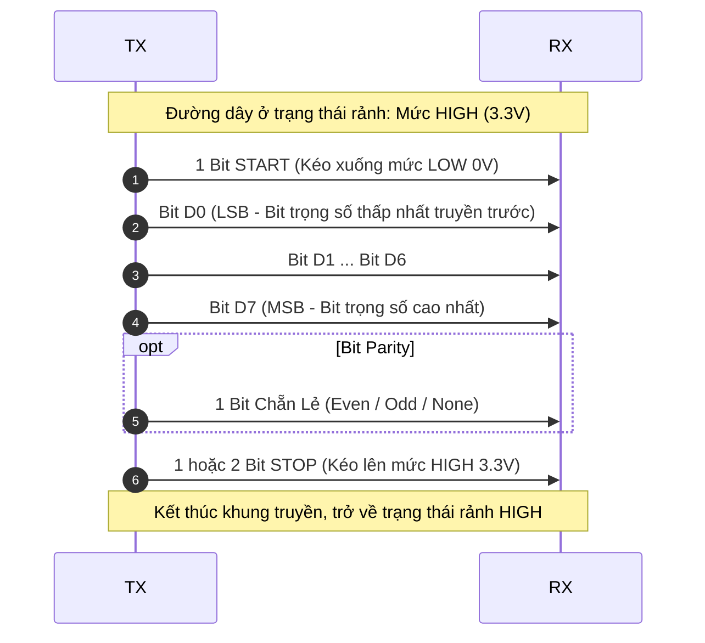

# Doc 1.6: Giao tiếp Nối tiếp Bất đồng bộ UART & Kỹ thuật Xử lý Luồng Dữ liệu Serial

### 1. Nguyên lý Giao tiếp UART Bất đồng bộ

Giao tiếp **UART (Universal Asynchronous Receiver-Transmitter)** là chuẩn truyền thông nối tiếp điểm - điểm (Point-to-Point) không đồng bộ kinh điển nhất trong kỹ thuật nhúng và hàng không vũ trụ:

- **Tính chất Bất đồng bộ (Asynchronous):** Không có đường dây phát xung nhịp Clock chung giữa hai thiết bị. Hai bên truyền và nhận phải được cài đặt cùng một tốc độ truyền định trước (**Baud rate**) và tự căn chỉnh thời gian dựa trên các cạnh chuyển tiếp của tín hiệu.
- **Cấu trúc Đường truyền:** Chỉ sử dụng đúng 2 dây tín hiệu:
  - `TX (Transmit)`: Đường xuất dữ liệu từ thiết bị phát.
  - `RX (Receive)`: Đường nhận dữ liệu vào thiết bị thu (Nối chéo: TX_A → RX_B và RX_A → TX_B).

### 2. Cấu hình Cổng Serial & Khung Truyền SERIAL_8N1

Khung truyền nối tiếp chuẩn mực nhất của ngành công nghiệp là **SERIAL_8N1**:

- **8 Bit Dữ liệu (Data bits):** Đủ để truyền chính xác 1 byte dữ liệu hoặc 1 ký tự mã ASCII chuẩn ($0 - 255$).
- **No Parity (Không kiểm tra chẵn lẻ):** Không thêm bit kiểm tra, giúp tối ưu hóa băng thông truyền dẫn.
- **1 Bit Stop (1 Dừng):** Duy trì mức cao tối thiểu trong thời gian 1 bit trước khi cho phép bắt đầu khung truyền tiếp theo.
- **Thời gian truyền 1 Byte:**
  Tổng số bit cần truyền cho 1 byte là: 1 Start + 8 Data + 1 Stop = 10 bit.
  Ở tốc độ baud chuẩn 115200 bps, thời gian truyền 1 bit là:
$$T_{\text{bit}} = \frac{1}{115200} \approx 8.68\,\mu\text{s} \implies T_{\text{byte}} = 10 \times 8.68\,\mu\text{s} \approx 86.8\,\mu\text{s}$$

  Tốc độ truyền dữ liệu hữu ích cực đại đạt: ≈ 11520 Byte/s ≈ 11.25 KB/s.

### 3. Ba Cổng UART Phần cứng trên ESP32

Vi điều khiển ESP32 tích hợp sẵn 3 khối phần cứng UART độc lập:

1. **UART0 (Serial):** Cổng UART nối tiếp mặc định được nối trực tiếp với chip nạp USB-UART trên bo mạch, dùng cho việc nạp mã nguồn từ Web IDE và in nhật ký gỡ lỗi ra cửa sổ Serial Monitor.
2. **UART1:** Cổng UART thứ hai trên chip, có thể được ánh xạ (remap) linh hoạt qua ma trận chuyển mạch GPIO Matrix sang các chân ngoại vi thích hợp (như kết nối module LoRa).
3. **UART2 (Serial2):** Cổng nối tiếp phần cứng được dành riêng cho việc giao tiếp với module vệ tinh định vị GNSS L76X hoặc cụm cảm biến Camera Payload.
