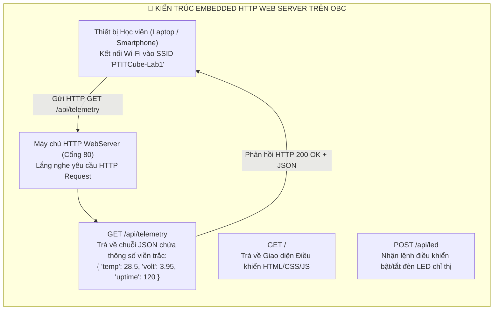

# Doc 1.7: Lý thuyết Mạng Không dây Wi-Fi, Embedded HTTP Web Server & Chế độ SoftAP

### 1. Kiến trúc Wi-Fi trên ESP32 & Chế độ SoftAP (Access Point)

Khối vô tuyến Wi-Fi tích hợp trên ESP32 hỗ trợ đầy đủ các chuẩn 802.11 b/g/n ở dải tần 2.4 GHz. Trong đào tạo và phát triển vệ tinh, Wi-Fi đóng vai trò như một kênh kiểm thử mô phỏng không dây tầm gần (Wireless Test Harness):

- **Chế độ Máy khách (Station Mode - STA):** ESP32 kết nối vào một mạng Wi-Fi có sẵn (như router phòng lab) và nhận một địa chỉ IP nội bộ từ máy chủ DHCP.
- **Chế độ Điểm truy cập Mềm (SoftAP Mode):** ESP32 tự mình biến thành một trạm phát sóng Wi-Fi độc lập, tự cấp phát địa chỉ IP cho các thiết bị kết nối vào (mặc định là `192.168.4.1`). Học viên dùng laptop hoặc điện thoại kết nối thẳng vào mạng của vệ tinh mà không phụ thuộc vào hạ tầng mạng bên ngoài.

### 2. Máy chủ Web HTTP Nhúng (Embedded Web Server)

OBC thực thi thư viện `WebServer.h` trên cổng mạng tiêu chuẩn $80$:

- **Cơ chế Định tuyến (URL Routing):** Sử dụng phương thức `server.on("/endpoint", HTTP_METHOD, handler_function)` để đăng ký các hàm xử lý tương ứng với từng yêu cầu từ phía người dùng.
- **Xử lý Đa nhiệm & Không chặn luồng (Non-blocking):** Trong hàm `loop()`, hàm `server.handleClient()` bắt buộc phải được gọi liên tục để kiểm tra và phục vụ kịp thời các gói tin HTTP gửi đến từ trình duyệt mà không làm treo các tác vụ bay khác.
