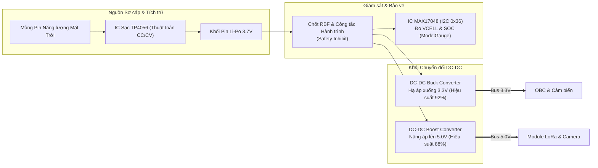

# Doc 2.1: Tổng quan Phân hệ Năng lượng EPS, Công nghệ Pin & Mạch Đo Dung Lượng MAX17048

### 1. Vai trò Sinh tồn của Phân hệ Năng lượng (EPS - Electrical Power System)
Phân hệ Năng lượng được ví như "Trái tim" của vệ tinh CubeSat. Trong không gian vũ trụ, nếu hệ thống năng lượng bị gián đoạn dù chỉ vài mili-giây, toàn bộ máy tính và tải trọng sẽ sập nguồn tức thì. EPS gánh vác các trọng trách cốt lõi:
- **Tích trữ Năng lượng Sơ cấp (Energy Storage):** Lưu trữ điện năng trong các cell pin hóa học để duy trì sự sống cho vệ tinh khi đi qua vùng tối của Trái Đất (Eclipse).
- **Quản lý Nạp Năng lượng Thông minh (Battery Charging):** Điều phối dòng sạc từ các tấm pin quang điện (Solar Panels) vào khối pin theo thuật toán an toàn, bảo vệ chống quá nạp hoặc quá nhiệt.
- **Biến đổi & Ổn định Điện áp (Power Conversion & Conditioning):** Chuyển đổi điện áp không ổn định của pin thành các đường bus điện áp sạch (3.3V và 5.0V) cung cấp cho các tải tiêu thụ.
- **Giám sát Năng lượng Thời gian thực (Fuel Gauging):** Đo đạc liên tục điện áp, dòng điện tiêu thụ và phần trăm dung lượng còn lại (State of Charge - SOC) để OBC ra quyết định sa thải phụ tải khi pin yếu.
- **Cơ chế Cách ly An toàn Phóng (Launch Safety Inhibit):** Đảm bảo vệ tinh hoàn toàn "chết điện" trong suốt quá trình phóng tên lửa cho tới khi được đẩy ra ngoài vũ trụ.

### 2. Đặc tính Hóa học và Vận hành của Pin Lithium Polymer (Li-Po)
Kit vệ tinh PTITCube sử dụng pin sạc **Lithium-ion Polymer (Li-Po)** dạng túi phẳng (Pouch Cell) với các đặc tính kỹ thuật quan trọng:
- **Điện áp Danh định (Nominal Voltage):** 3.7V trên mỗi cell.
- **Điện áp Sạc Đầy (Fully Charged Cut-off):** 4.20V ± 0.05V. Không bao giờ được sạc vượt quá 4.25V vì sẽ gây phân hủy chất điện phân, sinh khí áp suất cao làm phồng nổ pin.
- **Điện áp Xả Kiệt Nguy hiểm (Cut-off Threshold):** 3.00V. Nếu xả dưới 2.7V, cấu trúc tinh thể của các điện cực sẽ bị phá hủy vĩnh viễn (Dead Cell), pin không thể hồi phục dung lượng.
- **Đồ thị Phóng điện (Discharge Curve):** Đường cong điện áp xả của pin Li-Po rất dốc ở vùng 10% đầu ($4.2\text{V} \to 3.8\text{V}$), cực kỳ phẳng ở vùng 80% dung lượng trung tâm ($3.8\text{V} \to 3.65\text{V}$), và rơi tự do cắm đầu ở 10% cuối ($3.65\text{V} \to 3.0\text{V}$). Do đó, không thể ước lượng chính xác phần trăm dung lượng pin chỉ bằng cách đo điện áp tĩnh đơn thuần!

### 3. Thuật toán Sạc Chuẩn CC/CV với IC Sạc Chuyên Dụng TP4056
Khối nạp nguồn sử dụng vi mạch điều khiển sạc tuyến tính chuyên dụng **TP4056** thực hiện chu trình sạc hai giai đoạn hoàn hảo:
1. **Giai đoạn Dòng không đổi (Constant Current - CC):**
   - Khi pin có điện áp từ 3.0V đến dưới 4.2V, mạch bơm một dòng điện sạc không đổi tối đa $I_\text{chg}$ vào pin.
   - Dòng sạc được thiết lập thông qua điện trở gắn ở chân `PROG` ($R_\text{prog}$) theo công thức của nhà sản xuất:
$$I_\text{chg} = \frac{1200\text{ V}}{R_\text{prog}}$$
     Ví dụ: Với điện trở $R_\text{prog} = 1.2\text{ k}\Omega$, dòng nạp tối đa là $I_\text{chg} = 1000\text{ mA} = 1.0\text{ A}$.
2. **Giai đoạn Áp không đổi (Constant Voltage - CV):**
   - Khi điện áp pin đạt chính xác ngưỡng 4.20V, mạch tự động chuyển sang chế độ áp không đổi, giữ điện áp ở mức 4.20V và để dòng điện giảm dần theo hàm mũ.
   - Khi dòng điện giảm xuống dưới $1/10$ dòng sạc định mức ($C/10 \approx 100\text{ mA}$), chip TP4056 ngắt sạc hoàn toàn, chân trạng thái `CHRG` tắt và chân `STDBY` bật sáng báo pin đầy.

### 4. Mạch Chuyển đổi Nguồn Chuyển mạch DC-DC Buck và Boost
Để cấp nguồn cho các phân hệ, bo mạch EPS tích hợp hai mạch ổn áp chuyển mạch (Switching Regulators) với hiệu suất vượt trội so với ổn áp tuyến tính LDO:
- **DC-DC Buck Converter (Hạ áp $V_\text{bat} \to 3.3\text{V}$):** Cung cấp dòng điện liên tục lên tới 2 A cho OBC, bộ nhớ Flash và các cảm biến. Hiệu suất chuyển đổi đạt $\sim 92\%$, giảm thiểu tối đa tổn hao nhiệt sinh ra bên trong lòng vệ tinh.
- **DC-DC Boost Converter (Nâng áp $V_\text{bat} \to 5.0\text{V}$):** Khi điện áp pin xả xuống 3.4V, mạch Boost vẫn duy trì điện áp 5.0V ổn định cấp nguồn cho tầng khuếch đại công suất phát sóng của module LoRa và module Camera.

### 5. IC Giám Sát Nhiên Liệu Pin MAX17048 qua Giao thức I2C
Trên bo EPS, chip **MAX17048** của hãng Maxim Integrated đo đạc liên tục dung lượng pin với độ chính xác cao:
- **Địa chỉ I2C Cố định:** `0x36` (dạng 7-bit).
- **Thuật toán Độc quyền ModelGauge:** Theo dõi hành vi động học của cell pin, liên tục bù trừ theo nhiệt độ và tốc độ xả để tính toán chính xác tỷ lệ phần trăm dung lượng pin còn lại (State of Charge - SOC) mà **không cần mắc điện trở Shunt nối tiếp gây suy hao dòng điện**.
- **Các Thanh ghi Trọng yếu:**
  - Thanh ghi Điện áp Cell (`VCELL` - Địa chỉ `0x02` và `0x03`): Giá trị 16-bit. Độ phân giải là $78.125\text{ }\mu\text{V}$ trên mỗi bit (tương đương $1.25\text{ mV} / 16\text{ LSB}$).
$$V_\text{cell}\text{ (V)} = \text{RegValue} \times 0.000078125\text{ V}$$
  - Thanh ghi Tỷ lệ Dung lượng (`SOC` - Địa chỉ `0x04` và `0x05`): Giá trị 16-bit. Byte cao thể hiện phần nguyên phần trăm (0 - 100%), byte thấp thể hiện phần thập phân với độ phân giải $1/256\% \approx 0.0039\%$.
