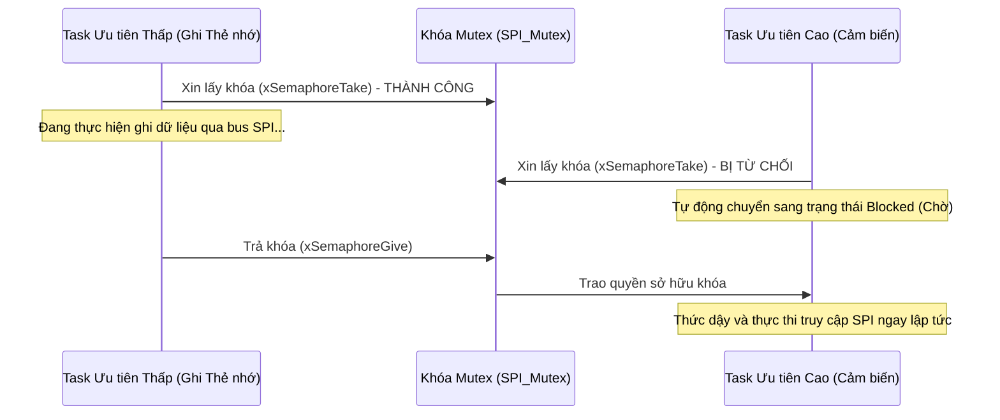

# Doc 3.3: Tranh Chấp Tài Nguyên, Cơ Chế Khóa Bảo Vệ & Kỹ Thuật Ngăn Ngừa Deadlock

### 1. Hiện tượng Tranh chấp Tài nguyên (Race Condition)
Khi hệ thống chạy đa tác vụ, các tài nguyên phần cứng duy nhất (như bus SPI của thẻ nhớ, cổng Serial Monitor, bus I2C) trở thành **Tài nguyên Dùng chung (Shared Resources)**:
- Nếu `TaskTelemetry` đang mở tệp và ghi dở 50 byte đầu tiên thì bị `TaskCommand` có độ ưu tiên cao hơn chiếm quyền CPU và cũng nhảy vào ghi tệp trên cùng thẻ nhớ qua bus SPI, dữ liệu của hai tác vụ sẽ bị trộn lẫn vào nhau gây lỗi vỡ khung tệp tin nghiêm trọng.

### 2. Khóa Loại trừ Tương hỗ Mutex (Mutual Exclusion)
Để bảo vệ tài nguyên dùng chung, FreeRTOS cung cấp cơ chế khóa **Mutex** (`SemaphoreHandle_t`):
- Quy tắc: "Ai giữ chìa khóa thì mới được vào phòng".
- Trước khi truy cập thẻ nhớ hoặc bus SPI, tác vụ bắt buộc phải gọi hàm xin khóa: `xSemaphoreTake(xSPIMutex, portMAX_DELAY)`.
- Sau khi hoàn thành việc ghi dữ liệu, tác vụ bắt buộc phải nhả khóa: `xSemaphoreGive(xSPIMutex)`.
- Các tác vụ khác muốn truy cập tài nguyên trong thời gian này sẽ tự động chuyển sang trạng thái chờ (Blocked), giải phóng chu kỳ CPU cho các công việc khác.

### 3. Vấn đề Nghịch đảo Mức Ưu tiên (Priority Inversion) & Cơ chế Thừa kế Ưu tiên (Priority Inheritance)
- **Sự cố Lịch sử Mars Pathfinder (1997):** Tàu đổ bộ Sao Hỏa liên tục bị reset phần mềm bí ẩn giữa sa mạc Sao Hỏa do một lỗi thiết kế RTOS kinh điển:
  - Tác vụ ưu tiên thấp giữ khóa tài nguyên chung.
  - Tác vụ ưu tiên cao cần tài nguyên nên bị chặn lại chờ đợi.
  - Một tác vụ ưu tiên trung bình (không cần tài nguyên đó) bất ngờ thức dậy và chiếm quyền CPU suốt một thời gian dài, gián tiếp ngăn không cho tác vụ ưu tiên thấp nhả khóa, khiến tác vụ ưu tiên cao bị "bỏ đói" (Starvation) dẫn tới vi phạm deadline khẩn cấp.
- **Giải pháp Thừa kế Ưu tiên (Priority Inheritance):** Khi tác vụ ưu tiên cao bị chặn bởi một Mutex do tác vụ ưu tiên thấp nắm giữ, hệ điều hành tạm thời **nâng mức ưu tiên của tác vụ thấp lên ngang bằng với tác vụ cao**, giúp nó nhanh chóng hoàn thành công việc và nhả khóa, sau đó trả lại mức ưu tiên ban đầu.

### 4. Hiện tượng Bế tắc (Deadlock / Deadly Embrace)
Xảy ra khi hai tác vụ cùng chờ tài nguyên mà tác vụ kia đang nắm giữ:
- `Task 1` đang giữ khóa Mutex A và muốn lấy khóa Mutex B.
- `Task 2` đang giữ khóa Mutex B và muốn lấy khóa Mutex A.
- Hậu quả: Cả hai tác vụ bị treo vĩnh viễn, kéo sập hệ điều hành.
- **Quy tắc Phòng ngừa:** Luôn luôn chiếm giữ các khóa theo một thứ tự phân cấp cố định trong toàn bộ dự án phần mềm.
