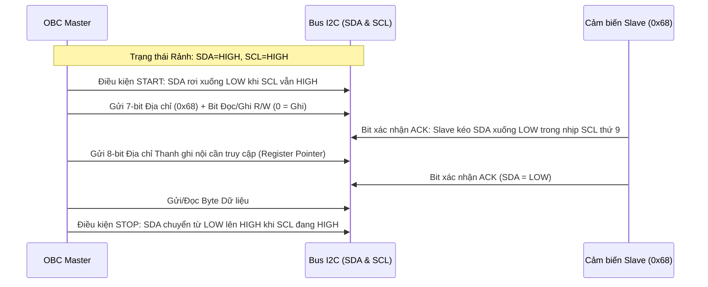

# Doc 4.1: Đi Sâu Giao thức I2C Chuẩn Công Nghiệp & Mạng Cảm Biến Đa Điểm

### 1. Vai trò của Phân hệ Cảm biến & Tải trọng trong Sứ mệnh Không gian
Phân hệ Cảm biến đóng vai trò là "Giác quan" của vệ tinh CubeSat, cho phép vệ tinh cảm nhận được các thông số vật lý của bản thân và môi trường quỹ đạo:
- **Quan trắc Khí quyển & Kín khí (Atmospheric & Seal Integrity):** Theo dõi áp suất và nhiệt độ bên trong lòng khung để phát hiện rò rỉ khí hoặc quá nhiệt linh kiện.
- **Xác định Tư thế Không gian (Attitude Determination):** Đo đạc vận tốc góc quay và véc-tơ gia tốc trọng trường/quán tính bằng cảm biến quán tính 6 bậc tự do (6-DOF IMU) để phục vụ thuật toán dập tắt chuyển động quay hỗn loạn (Detumbling).
- **Định vị & Đồng bộ Thời gian (Navigation & Timing):** Cung cấp kinh độ, vĩ độ, độ cao quỹ đạo và tín hiệu nhịp thời gian nguyên tử UTC chuẩn xác cho các sự kiện khoa học.
- **Tải trọng Quang học Viễn thám (Earth Observation Payload):** Chụp ảnh màu độ phân giải cao bề mặt Trái Đất, nén dữ liệu ảnh phục vụ các nhiệm vụ nghiên cứu khoa học.

### 2. Nguyên lý Hoạt động Chi tiết của Giao thức Nối tiếp I2C (Inter-Integrated Circuit)
Bus **I2C** do hãng Philips (nay là NXP) phát triển là một bus truyền thông nối tiếp đồng bộ 2 dây hai chiều, cực kỳ phổ biến trong các hệ thống vệ tinh nhỏ nhờ khả năng kết nối nhiều IC cảm biến chỉ với hai chân vi điều khiển duy nhất:
- **Hai Đường Tín hiệu:**
  - **SDA (Serial Data):** Đường truyền dữ liệu bit nối tiếp hai chiều.
  - **SCL (Serial Clock):** Đường truyền xung nhịp đồng bộ do Master phát ra.
- **Cấu trúc Phần cứng Cực thu Hở (Open-Drain) & Điện trở Kéo lên (Pull-up Resistors):**
  - Cả Master và tất cả các thiết bị Slave đều không có tầng đệm kéo lên nguồn tích cực bên trong chân chip mà sử dụng bóng bán dẫn cực máng/cực thu hở (Open-Drain / Open-Collector). Chân chip chỉ có thể chủ động kéo đường dây xuống mức `LOW` (nối mass GND) hoặc thả nổi.
  - Một cặp điện trở kéo lên ngoài ($R_p$, thông thường từ 2.2 kΩ đến 4.7 kΩ) bắt buộc phải được mắc từ đường SDA và SCL lên nguồn 3.3V.
  - Khi không có thiết bị nào truyền tin, điện trở kéo lên giữ cho đường bus luôn ở mức logic `HIGH`.
  - Thiết kế này tạo ra cổng logic "HOẶC có dây" (Wired-AND), triệt tiêu hoàn toàn nguy cơ đoản mạch làm cháy chip khi hai thiết bị vô tình phát xung đối nghịch cùng lúc.

### 3. Khung Truyền Dữ liệu & Các Trạng thái Điều khiển
1. **Điều kiện START và STOP (Bắt đầu và Kết thúc):**
   - Trong quá trình truyền dữ liệu bình thường, đường SDA chỉ được phép thay đổi trạng thái khi SCL đang ở mức `LOW`. Khi SCL ở mức `HIGH`, đường SDA bắt buộc phải giữ ổn định.
   - **START Condition:** SDA chuyển trạng thái từ `HIGH` xuống `LOW` trong khi SCL đang ở mức `HIGH`. Báo hiệu đường bus bắt đầu bận.
   - **STOP Condition:** SDA chuyển trạng thái từ `LOW` lên `HIGH` trong khi SCL đang ở mức `HIGH`. Báo hiệu kết thúc phiên truyền tin, trả bus về trạng thái rảnh rỗi.
2. **Địa chỉ Thiết bị 7-bit & Bit R/W:**
   - Byte đầu tiên sau điều kiện START bao gồm 7 bit địa chỉ thiết bị Slave (2⁷ = 128 địa chỉ khả dĩ) và bit thứ 8 là bit chọn chiều dữ liệu:
     - Bit 8 = `0`: Thao tác Ghi dữ liệu từ Master sang Slave.
     - Bit 8 = `1`: Thao tác Đọc dữ liệu từ Slave về Master.
3. **Bit Xác nhận ACK và Phản hồi NACK:**
   - Trong nhịp xung SCL thứ 9, thiết bị nhận dữ liệu phải phản hồi một bit:
     - **ACK (Acknowledge):** Kéo đường SDA xuống mức `LOW`, báo hiệu đã nhận byte dữ liệu thành công và sẵn sàng nhận tiếp.
     - **NACK (Not Acknowledge):** Thả nổi đường SDA ở mức `HIGH`, báo hiệu thiết bị bận, gặp lỗi hoặc Master muốn kết thúc phiên đọc chuỗi byte.
4. **Kỹ thuật Kéo dãn Xung nhịp (Clock Stretching):**
   - Khi một cảm biến Slave chậm chưa kịp chuẩn bị xong dữ liệu hoặc đang bận chuyển đổi ADC nội bộ, nó có quyền kéo đường SCL xuống mức `LOW`. Master phát hiện đường SCL bị giữ ở mức thấp sẽ tự động tạm dừng đồng hồ xung nhịp cho tới khi Slave nhả SCL lên mức cao mới truyền tiếp.
5. **Kỹ thuật Đọc Khối Dữ liệu Nhanh (Burst Read / Auto-Increment):**
   - Hầu hết các cảm biến hiện đại (BMP280, MPU6500) đều hỗ trợ con trỏ địa chỉ tự tăng. Master chỉ cần gửi địa chỉ thanh ghi khởi đầu một lần duy nhất, sau đó phát liên tục các xung nhịp đọc; cảm biến sẽ tự động đẩy tuần tự toàn bộ mảng dữ liệu (ví dụ 14 byte từ 0x3B đến 0x48 của MPU6500) mà không cần lặp lại điều kiện START/STOP, giúp tăng tốc độ đọc dữ liệu lên gấp 5 lần.

---

### 4. Cảm biến Môi trường Khí áp & Nhiệt độ BMP280
- **Nhà sản xuất & Địa chỉ I2C:** Bosch Sensortec. Địa chỉ I2C cấu hình bằng chân SDO: `0x76` (SDO nối GND) hoặc `0x77` (SDO nối VDD).
- **Dải Đo & Độ phân giải:** Đo áp suất khí quyển từ 300 hPa đến 1100 hPa (tương đương độ cao từ $-500\text{m}$ dưới mực nước biển đến $+9000\text{m}$ trên đỉnh Everest) với độ phân giải siêu cao 0.16 Pa và độ phân giải nhiệt độ 0.01°C.
- **Bảng Hệ số Hiệu chuẩn Nội bộ (Trimming Parameters):**
  - Màng cảm biến áp suất gốm áp điện (Piezoresistive) có đặc tính phi tuyến tính cao theo nhiệt độ. Trong quá trình sản xuất tại nhà máy, mỗi chip BMP280 được đo kiểm riêng lẻ và nạp sẵn 24 byte hằng số hiệu chuẩn vào bộ nhớ ROM không khả biến (từ thanh ghi `0x88` đến `0xA1`: `dig_T1` đến `dig_T3` cho nhiệt độ, `dig_P1` đến `dig_P9` cho áp suất).
  - Thuật toán giải mã bắt buộc phải đọc toàn bộ mảng 24 byte hằng số này và áp dụng công thức bù trừ nhiệt độ bậc cao theo tài liệu chuẩn của Bosch để quy đổi giá trị ADC thô thành giá trị áp suất thực tế.
- **Công thức Tính Độ cao Khí quyển (Barometric Hypsometric Formula):**
$$h = 44330 \times \left[ 1 - \left(\frac{P}{P_0}\right)^{\frac{1}{5.255}} \right]$$
  Trong đó: $h$ là độ cao tính bằng mét, $P$ là áp suất khí quyển đo được, $P_0$ là áp suất chuẩn tại mực nước biển (1013.25 hPa).
