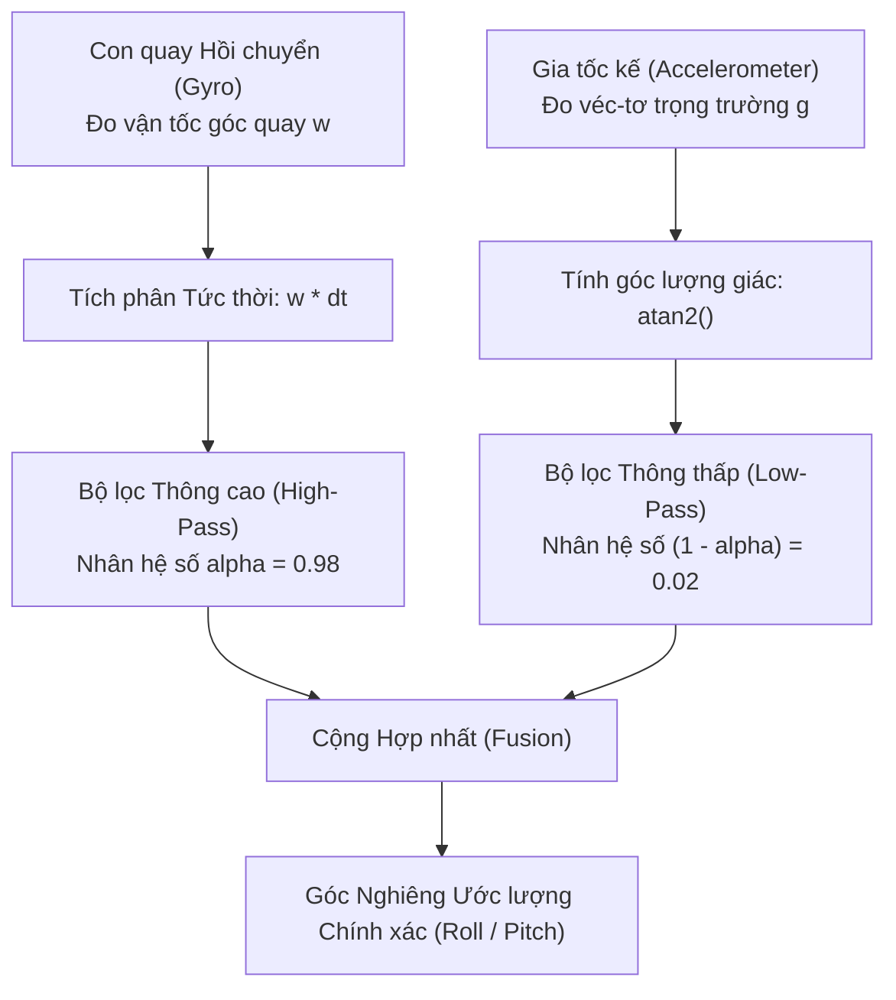

# Doc 4.2: Cảm Biến Quán Tính 6 Trục IMU MPU6500 & Thuật Toán Bộ Lọc Bù

### 1. Cảm biến Quán tính IMU 6 Trục MPU6500
- **Nhà sản xuất & Địa chỉ I2C:** InvenSense / TDK. Địa chỉ I2C là `0x68` (AD0 = GND) hoặc `0x69` (AD0 = VCC).
- **Cấu trúc Phần cứng:** Tích hợp một vi cơ điện tử gia tốc kế 3 trục (MEMS 3-axis Accelerometer) và con quay hồi chuyển 3 trục (MEMS 3-axis Gyroscope) trên cùng một đế silicon.
- **Thanh ghi Dữ liệu Thô:** 14 thanh ghi liên tiếp từ `0x3B` đến `0x48` chứa các giá trị số nguyên có dấu 16-bit (`int16_t`):
  - `0x3B - 0x40`: Gia tốc 3 trục $A_x, A_y, A_z$ (độ nhạy cấu hình ±2g, ±4g, ±8g, ±16g).
  - `0x41 - 0x42`: Nhiệt độ nội bộ của chip silicon.
  - `0x43 - 0x48`: Vận tốc góc 3 trục $G_x, G_y, G_z$ (độ nhạy cấu hình ±250, ±500, ±1000, ±2000°/s).

### 2. Cảm biến Từ trường & La bàn số GY-271 (QMC5883L / HMC5883L)
- **Nhà sản xuất & Địa chỉ I2C:** QST / Honeywell. Địa chỉ I2C chuẩn là `0x0D` (QMC5883L / QMC5883P) hoặc `0x1E` (HMC5883L).
- **Cấu trúc Phần cứng:** Tích hợp 3 cảm biến từ điện trở dị hướng (Anisotropic Magnetoresistive - AMR) độ nhạy cao đo cường độ từ trường Trái Đất theo 3 trục trực giao $M_x, M_y, M_z$ (đơn vị Gauss hoặc $\mu\text{T}$).
- **Thuật toán Tính Góc Hướng La bàn (Heading):**
  Góc hướng la bàn so với cực Bắc từ được tính bằng hàm lượng giác:
$$\text{Heading} = \text{atan2}(M_y, M_x) \cdot \frac{180}{\pi}$$
  Nếu $\text{Heading} < 0^\circ$, hiệu chỉnh: $\text{Heading} = \text{Heading} + 360^\circ$.
- **Hợp nhất Dữ liệu Quán tính 9 Bậc Tự do (9-DOF):** 
  Kết hợp gia tốc kế 3 trục (đo véc-tơ trọng trường), con quay hồi chuyển 3 trục (đo vận tốc góc) từ MPU6500 và từ kế 3 trục (đo véc-tơ từ trường Trái Đất) từ GY-271 cho phép phân hệ ADCS của vệ tinh xác định đầy đủ và ổn định cả 3 góc Euler trong không gian 3 chiều: Roll $\phi$, Pitch $\theta$ và Yaw / Heading $\psi$.
- **Chuẩn hóa Định dạng Log Serial:** Dữ liệu cảm biến được in theo từng cụm 3 trục trên một dòng (`ACCEL: ...`, `GYRO: ...`, `MAG: ...`), loại bỏ hoàn toàn các tiền tố ngoặc vuông `[...]` rườm rà.

### 3. Thuật toán Lọc Bù (Complementary Filter) Ước lượng Tư thế
Để tính toán góc nghiêng (Roll $\phi$, Pitch $\theta$) của vệ tinh, mỗi cảm biến đơn lẻ đều có nhược điểm chí mạng:
- **Gia tốc kế:** Đo véc-tơ gia tốc trọng trường $g$. Cho góc nghiêng chính xác tuyệt vời khi ở trạng thái tĩnh dài hạn, nhưng lại cực kỳ nhạy cảm với các rung động cơ học ngắn hạn và lực quán tính lúc chuyển động (Nhiễu tần số cao).
- **Con quay hồi chuyển:** Đo vận tốc góc quay tức thời $\omega$. Tích phân góc quay $\theta = \int \omega \, dt$ đáp ứng cực nhanh và không bị ảnh hưởng bởi rung lắc cơ học, nhưng lại bị hiện tượng trôi dạt điểm không (Gyro Drift / DC Bias) khiến góc tính toán bị sai lệch tích lũy tăng dần theo thời gian (Nhiễu tần số thấp).
- **Bộ Lọc Bù (Complementary Filter):** Kết hợp một bộ lọc thông cao (High-pass Filter) cho con quay và một bộ lọc thông thấp (Low-pass Filter) cho gia tốc kế theo công thức hợp nhất:
$$\theta_t = \alpha \cdot (\theta_{t-1} + \omega \cdot \Delta t) + (1 - \alpha) \cdot \theta_\text{accel}$$
  Trong đó: $\Delta t$ là chu kỳ lấy mẫu, $\alpha$ là trọng số lọc (thường chọn $\alpha = 0.96 - 0.98$). Thuật toán chạy siêu nhanh trên vi điều khiển, triệt tiêu hoàn toàn độ trôi của con quay và lọc sạch nhiễu rung lắc của gia tốc kế.

