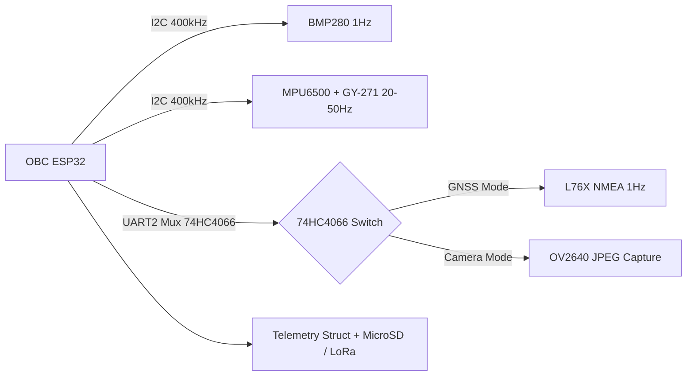

# Doc 4.7: Kiến Trúc Thu Thập & Xử Lý Dữ Liệu Đa Cảm Biến Toàn Diện

### 1. Mục tiêu Chu trình Đa Cảm biến Khép kín
- Trong thực tế vận hành vệ tinh 1U, OBC phải thu thập dữ liệu từ nhiều phân hệ cảm biến có giao thức và tốc độ khác nhau (I2C nhanh, cảm biến khí áp chậm, UART chia sẻ giữa GNSS L76X và Camera OV2640 qua IC chuyển mạch 74HC4066) rồi gom về một cấu trúc bản tin viễn trắc thống nhất (`struct TelemetryPacket`).

### 2. Nguyên tắc Thiết kế Lịch Lấy mẫu & Gắn Nhãn Thời gian
- **Đóng dấu thời gian (Timestamping):** Mỗi gói mẫu phải gắn mốc `millis()` (và/hoặc giờ UTC trích xuất từ bản tin GNSS) để trạm mặt đất đối chiếu đồng bộ giữa tư thế, áp suất và vị trí quỹ đạo.
- **Phân tầng chu kỳ lấy mẫu (Multi-rate Scheduling):**
  - Cảm biến quán tính IMU 6/9 trục (MPU6500 / GY-271): đọc tần số cao ($20 - 50\text{ Hz}$) để bộ lọc bù không bị trôi góc.
  - Cảm biến khí áp & nhiệt độ BMP280: đọc chu kỳ chậm hơn ($1 - 2\text{ Hz}$).
  - Module định vị GNSS L76X: cập nhật theo tốc độ chốt vị trí $1\text{ Hz}$, đồng thời **đánh dấu cờ hợp lệ (`gpsValid`)** rõ ràng khi chưa có fix thay vì xuất tọa độ `0.0` gây hiểu nhầm.
- **Không chặn luồng & Chia sẻ UART an toàn:** Tuyệt đối không để cảm biến chậm hoặc chờ bản tin NMEA làm nghẽn vòng lặp lấy mẫu IMU; khi cần chụp ảnh OV2640, chuyển kênh 74HC4066 có kiểm soát và trả lại kênh GNSS ngay sau `DONE`.

