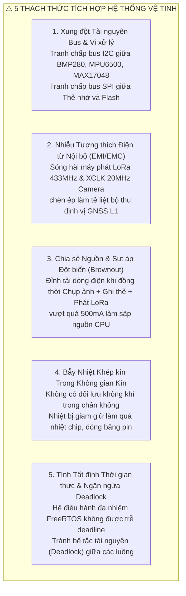

# Doc 7.1: Năm Thách Thức Kỹ Thuật Khốc Liệt Khi Tích Hợp Đa Phân Hệ vào Khối 1U

### 1. Tổng quan Bài toán Tích hợp Hệ thống (System Integration)
Giai đoạn Tích hợp Hệ thống là thời điểm quyết định của toàn bộ dự án vệ tinh, chuyển hóa các phân hệ phần cứng và phần mềm hoạt động riêng rẽ (OBC, EPS, C&DH, Sensors, COM, Khung cơ khí) thành một **thực thể vệ tinh duy nhất, tự chủ, bền bỉ và đồng bộ** có khả năng hoàn thành xuất sắc sứ mệnh trong môi trường khắc nghiệt ngoài không gian.

Khi nhồi nhét tất cả các phân hệ vào không gian chật hẹp của khối lập phương 1U (10 × 10 × 11.35 cm), kỹ sư tích hợp phải đối mặt và giải quyết đồng thời 5 thách thức kỹ thuật lớn:

### 2. Chi tiết Giải pháp Kỹ thuật Khắc phục 5 Thách thức
1. **Giải quyết Xung đột Bus I2C/SPI:**
   - *Vấn đề:* Bus I2C là tài nguyên dùng chung nối tiếp; nếu hai tác vụ phần mềm cùng truy cập đồng thời sẽ làm vỡ khung truyền tin và treo cứng cảm biến.
   - *Giải pháp:* Sử dụng khóa tương hỗ **Mutex (`xI2CMutex`)** trong FreeRTOS với cơ chế Thừa kế Ưu tiên (Priority Inheritance). Tác vụ nào muốn đọc cảm biến bắt buộc phải lấy Mutex (`xSemaphoreTake`), hoàn thành giao tiếp xong phải nhả khóa (`xSemaphoreGive`) mới cho tác vụ khác truy cập.
2. **Khắc phục Nhiễu Tương thích Điện từ (EMI Nội bộ):**
   - *Vấn đề:* Bộ phát sóng LoRa công suất cao (100 mW) và xung nhịp camera 20 MHz phát xạ điện từ làm giảm độ nhạy máy thu GPS.
   - *Giải pháp:* Bố trí mạch đất hình sao (**Star Grounding**), bọc màng đồng shield cách ly các đường tín hiệu RF và áp dụng cơ chế bật tắt On-Demand ngắt xung nhịp camera khi định vị GPS bằng IC chuyển mạch 74HC4066.
3. **Chống Sụt áp Nguồn (Brownout Mitigation):**
   - *Vấn đề:* Nếu camera nạp điện (250 mA), thẻ nhớ ghi khối (100 mA) và LoRa phát sóng (120 mA) cùng xảy ra trong 1 mili-giây, tổng dòng đỉnh vượt quá 500 mA sẽ làm sụt áp pin xuống dưới 2.7V gây sập nguồn OBC.
   - *Giải pháp:* Lập trình giãn cách thời gian kích hoạt các phụ tải công suất cao (Time-staggered execution) kết hợp mảng tụ lọc Tantalum dung lượng lớn.
4. **Quản lý Cân bằng Nhiệt Toàn diện:**
   - *Vấn đề:* Trong chân không, nhiệt lượng sinh ra từ OBC và mạch phát sóng bị giữ lại bên trong khung.
   - *Giải pháp:* Thiết kế lớp Anodize đen bên trong để hấp thụ nhiệt bức xạ, cầu nhiệt kim loại dẫn nhiệt trực tiếp ra khung nhôm ngoài để tản nhiệt vào vũ trụ, duy trì nhiệt độ pin luôn trong dải an toàn từ 0°C đến +45°C.
5. **Tính Tất định Thời gian thực & Ngăn ngừa Deadlock:**
   - *Vấn đề:* Phần mềm điều hành bay phải xử lý đồng thời nhiều luồng tín hiệu (chu kỳ đọc cảm biến 10Hz, ghi thẻ nhớ 1Hz, phát beacon 30s, ngắt nhận viễn lệnh vô tuyến bất kỳ lúc nào). Nếu thiết kế khóa không cẩn thận sẽ xảy ra hiện tượng kẹt bế tắc Deadlock.
   - *Giải pháp:* Thiết kế cấu trúc phân cấp khóa tài nguyên cố định và áp dụng kỹ thuật FreeRTOS Queue truyền dữ liệu bất đồng bộ.
