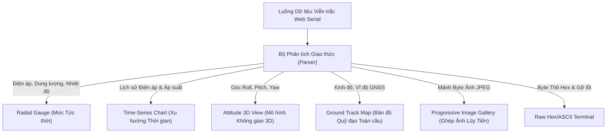

# Doc 8.2: Hướng Dẫn Lựa Chọn & Thiết Kế Khối Trực Quan Hóa (Widgets) trên Dashboard LMS

### 1. Nguyên lý Lựa chọn Khối Trực quan hóa Phù hợp
Bảng điều khiển (Mission Dashboard) là giao diện duy nhất để kíp trực trạm mặt đất nắm bắt được sức khỏe của vệ tinh. Việc lựa chọn đúng loại Widget trực quan hóa cho từng đại lượng dữ liệu là yếu tố then chốt giúp tránh sai lầm trong vận hành:

| Loại Widget Trực quan hóa | Thuộc tính & Dữ liệu Ánh xạ | Ngữ cảnh Sử dụng Tối ưu nhất |
| :--- | :--- | :--- |
| **Đồng hồ Kim tròn (Radial Gauge)** | Ánh xạ biến đơn có ngưỡng: $V_\text{bat}$, SOC, Nhiệt độ | Giám sát các đại lượng sinh mệnh tức thời; đổi màu cảnh báo từ Xanh sang Đỏ khi chạm ngưỡng nguy hiểm |
| **Đồ thị Chuỗi Thời gian (Time-Series Chart)** | Chuỗi thời gian: $V_\text{bat}(t)$, $P(t)$, $\text{RSSI}(t)$ | Phân tích xu hướng biến thiên liên tục theo thời gian; đánh giá chu kỳ nạp xả pin qua các pha sáng/tối |
| **Mô hình 3D (Attitude 3D View)** | Bộ ba góc Euler: Roll, Pitch, Yaw | Trực quan hóa chuyển động quay và tư thế không gian 3 chiều của vệ tinh thu nhận từ thuật toán lọc bù IMU |
| **Bản đồ Quỹ đạo (Ground Track Map)** | Tọa độ địa lý: Vĩ độ, Kinh độ, Độ cao | Hiển thị vết quét quỹ đạo vệ tinh trên bản đồ thế giới và vùng phủ sóng vô tuyến (Footprint) |
| **Bảng Byte thô (Raw Terminal)** | Luồng byte nhị phân Hexadecimal & chuỗi ASCII | Dành riêng cho kỹ sư giao thức kiểm tra tính toàn vẹn dữ liệu, kiểm tra mã CRC-16 và gỡ lỗi cấp thấp |
| **Trung tâm Phát lệnh (Uplink Console)** | Danh mục lệnh và tham số kèm nút bấm Arm/Execute | Gửi các mệnh lệnh điều hành có cơ chế xác nhận an toàn hai bước để ngăn chặn thao tác bấm nhầm |
| **Khung Ảnh Lũy tiến (Image Gallery)** | Mảng bộ đệm byte ảnh: Image Chunk Stream | Ghép và hiển thị dần bức ảnh bề mặt Trái Đất theo thời gian thực khi các gói mảnh được tải về từ không gian |

